<div align="center">

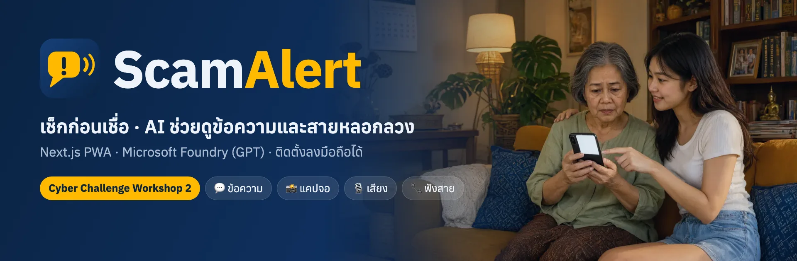

<br>

[](https://codespaces.new/codediva-train/scamalert?quickstart=1)

🌐 **ดูแอปที่ deploy แล้ว: [scamalert.azurewebsites.net](https://scamalert.azurewebsites.net/)**<br>
<sub>เว็บนี้ไว้ดูหน้าตาแอปเท่านั้น ไม่ได้ใส่ API key จึงตรวจจริงไม่ได้ — อยากลองตรวจ ให้รันใน Codespace ด้วย key ของคุณเอง</sub>


**แล็บ Online Workshop 2 · Thailand Cyber & Digital Innovation Challenge**<br>
เสาร์ 28 พฤศจิกายน 2569 · 09.00–12.00 น. · ออนไลน์ผ่าน Google Meet

[🚀 เริ่มใน 5 นาที](#-เริ่มใน-5-นาที) · [🎯 ภารกิจ 11 ขั้น](#-ภารกิจ-11-ขั้น) · [🧠 แอปทำงานยังไง](#-แอปทำงานยังไง) · [🗂️ 14 ประเภทคดี](#️-14-ประเภทคดีออนไลน์) · [💸 กันเสียเงิน](#-กันไม่ให้เสียเงิน) · [English](#english)

</div>

---

## ✨ ScamAlert คืออะไร

แอปเว็บที่ช่วยคนไทย **เช็กก่อนเชื่อ** — วางข้อความ แคปหน้าจอ หรืออัดเสียงที่น่าสงสัย แล้ว AI บอกว่าเป็นสแกมไหม เป็นคดีประเภทไหน และควรทำอะไรต่อ
สร้างด้วย **Next.js** เป็น **PWA** ที่กดติดตั้งลงมือถือได้เหมือนแอป และแพ็กขึ้น Store ได้ด้วย PWABuilder

<div align="center">
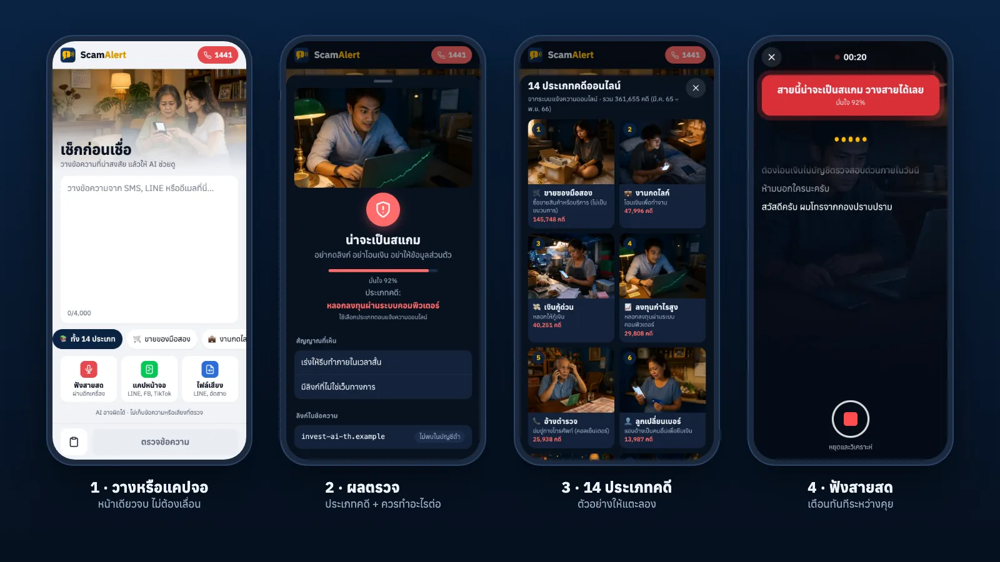
</div>

| | ตรวจจาก | ใช้ยังไง |
|:-:|---|---|
| 💬 | **ข้อความ** | วางจาก SMS, LINE, อีเมล · บน Android กด "แชร์" เข้าแอปได้เลย |
| 📸 | **แคปหน้าจอ** | แชต LINE / Messenger, โพสต์และโฆษณา Facebook, TikTok, IG — AI อ่านข้อความในภาพให้ |
| 🎙️ | **ไฟล์เสียง** | ข้อความเสียงจาก LINE หรือไฟล์อัดสาย |
| 📞 | **ฟังสายสด** | เปิดลำโพงโทรศัพท์ วางใกล้ **อีกเครื่อง** ที่เปิดแอปนี้ — เตือนทันทีเมื่อเริ่มเข้าข่ายสแกม |

> [!NOTE]
> **ทำไมฟังสายต้องใช้อีกเครื่อง?** ระหว่างโทร ทั้ง Android และ iOS จะปิดไมค์ของแอปอื่นทุกตัว
> แอปจะขึ้นเตือนเองถ้าไมค์เงียบเกิน 10 วินาที

---

## 🚀 เริ่มใน 5 นาที

> [!IMPORTANT]
> ต้องทำ **[pre-work](#-ก่อนวันอบรม-pre-work)** ให้เสร็จก่อน — มี Azure ของตัวเอง พร้อม key และชื่อ resource

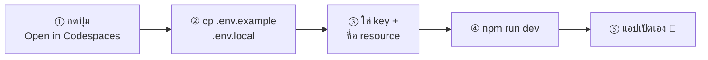

1. กดปุ่ม **[Open in GitHub Codespaces](https://codespaces.new/codediva-train/scamalert?quickstart=1)** ด้านบน → **Create codespace** รอ 2–3 นาที
2. ถ้าถามว่า *Do you trust the authors…?* กด **Trust Folder & Continue**
3. เปิด Terminal (☰ → Terminal → New Terminal) แล้วพิมพ์

   ```bash
   cd webapp
   cp .env.example .env.local
   ```

4. เปิดไฟล์ `webapp/.env.local` ใส่ค่าของคุณ แล้วกดบันทึก

   ```ini
   FOUNDRY_API_KEY=วาง-key-ของคุณ
   FOUNDRY_RESOURCE=ชื่อ-resource   # เช่น my-scam-lab
   ```

5. กลับไปที่ Terminal พิมพ์ `npm run dev` → แอปเปิดในแท็บใหม่ (หรือดูแท็บ **Ports** → พอร์ต 3000)

> [!TIP]
> ไม่รู้จะลองอะไร? แตะชิป **📚 ตัวอย่างทั้งหมด** ในแอป — มีข้อความครบ 14 ประเภทคดี, ภาพหน้าจอโซเชียลจำลอง 6 แบบ และคลิปเสียงโทรหลอก 5 คลิป (เสียง AI) · บนคอมฯ มีแผง **ภาพตัวอย่าง** ด้านขวา กดภาพเพื่อตรวจ หรือลากไปวางที่ปุ่ม **แคปหน้าจอ** ([ดูภาพทั้งหมด](#-ภาพหน้าจอตัวอย่าง-ไว้ลองอัปโหลด))

---

## 🎯 ภารกิจ 11 ขั้น

ทำตามลำดับ ติ๊กในใจทีละข้อ ✅ — **README นี้คือคู่มือของแล็บ** สไลด์ในห้องใช้ลำดับ 11 ข้อเดียวกัน

<table>
<tr><th>#</th><th>ภารกิจ</th><th>ได้อะไร</th></tr>
<tr><td>1</td><td>🖥️ เปิด Codespace</td><td>เครื่องพร้อม Node 22 + Azure CLI</td></tr>
<tr><td>2</td><td>🔐 ตั้ง <code>.env.local</code></td><td>key อยู่ฝั่ง server ไม่หลุดไปเบราว์เซอร์</td></tr>
<tr><td>3</td><td>▶️ <code>npm run dev</code></td><td>แอปรันบนพอร์ต 3000</td></tr>
<tr><td>4</td><td>🔎 ตรวจข้อความแรก</td><td>เห็นผลสองด่านครั้งแรก</td></tr>
<tr><td>5</td><td>📖 อ่าน <code>lib/scam.ts</code></td><td>เข้าใจ prompt + JSON schema</td></tr>
<tr><td>6</td><td>📚 ลองตัวอย่างทั้งหมด</td><td>ข้อความ 14 ประเภทคดี · เห็นว่า AI จัดประเภทแม่นแค่ไหน</td></tr>
<tr><td>7</td><td>✍️ ปรับ <code>TRIAGE_PROMPT</code></td><td>แก้เคสที่ AI ทายผิด</td></tr>
<tr><td>8</td><td>🧠 ด่านที่สอง (gpt-5.5)</td><td>คำอธิบาย + สิ่งที่ควรทำต่อ</td></tr>
<tr><td>9</td><td>📸🎙️ แท็บภาพหน้าจอ + คลิปเสียง</td><td>ตรวจแคปจอโซเชียลและสายโทรหลอก</td></tr>
<tr><td>10</td><td>📏 วัดผล</td><td>ความแม่น + ค่าใช้จ่ายต่อข้อความ</td></tr>
<tr><td>11</td><td>☁️ Deploy ขึ้น Azure</td><td>ลิงก์จริงเปิดบนมือถือ + ติดตั้งเป็นแอป</td></tr>
</table>

<details>
<summary>💡 <b>คำใบ้ภารกิจ 5 — อ่านโค้ดตรงไหนก่อนดี</b></summary>

<br>

เปิด [`webapp/lib/scam.ts`](webapp/lib/scam.ts) แล้วหา 3 อย่างนี้

- `TRIAGE_PROMPT` — คำสั่งที่บอก gpt-5.4-mini ว่าให้ตัดสินยังไง
- `TRIAGE_FORMAT` — JSON schema ที่บังคับให้ตอบเป็นโครงสร้างเดิมทุกครั้ง (`strict: true`)
- `checkMessage()` — ตรงนี้คือ "สองด่าน": ด่านแรกทุกข้อความ ด่านสองเฉพาะสแกม

</details>

<details>
<summary>💡 <b>คำใบ้ภารกิจ 7 — ปรับ prompt ยังไงให้แม่นขึ้น</b></summary>

<br>

1. แตะ **📚 ตัวอย่างทั้งหมด** ลองข้อความทั้ง 16 ข้อ จดเคสที่ทาย **ผิด** (ทั้งผิดว่าสแกมไหม และผิดประเภทคดี)
2. เพิ่มกฎใน `TRIAGE_PROMPT` ให้ตรงจุด เช่น *"ข้อความที่ขอให้โอนเงินก่อนรับของ ถือเป็นสแกมเสมอ"*
3. บันทึกไฟล์ — `npm run dev` โหลดใหม่ให้เอง — แล้วลองเคสเดิมอีกรอบ

> ตัวอย่างจริงจากการทำแอปนี้: คลิปเสียง "อ้างตำรวจกองปราบ" เคยถูกจัดเป็น *แอบอ้างเป็นคนอื่นเพื่อยืมเงิน* จนเพิ่มคำอธิบายใน `TRIAGE_PROMPT` ว่าคอลเซ็นเตอร์ = อ้างตำรวจ/ธนาคาร/ขนส่ง แล้วขู่ ส่วนแอบอ้าง = อ้างเป็นญาติหรือคนรู้จัก

> ทายผิดแบบ **"สแกมแต่บอกว่าปกติ"** อันตรายกว่า **"ปกติแต่บอกว่าสแกม"** มาก — ตัดสินใจให้ได้ว่าจะยอมพลาดด้านไหน แล้วเขียนเหตุผลลง Concept Proposal

</details>

<details>
<summary>💡 <b>คำใบ้ภารกิจ 10 — ค่าใช้จ่ายต่อข้อความ</b></summary>

<br>

| โมเดล | เข้า / ออก (ต่อ 1 ล้านโทเคน) | ใช้ตอนไหน |
|---|---|---|
| `gpt-5.4-mini` | $0.75 / $4.50 | ทุกข้อความ |
| `gpt-5.5` | $5 / $30 | เฉพาะสแกม |
| `gpt-5.4` | $2.50 / $15 | ตัวสำรองถ้า gpt-5.5 ไม่มีโควตา |

ดูยอดจริงที่ Azure portal → Cost Management · ด่านแรกถูกกว่าด่านสองราว 7 เท่า — นี่คือเหตุผลที่แยกสองด่าน

</details>

<details>
<summary>💡 <b>คำใบ้ภารกิจ 11 — deploy ขึ้น Azure App Service (ฟรี)</b></summary>

<br>

```bash
az login --use-device-code
cd webapp
APP_NAME=scam-check-<ชื่อทีม> ./deploy-azure.sh
```

ถ้าขึ้น *"Operation cannot be completed without additional quota … F1 … 0"* แปลว่า subscription นี้ไม่มีโควตาแผนฟรี ลอง region อื่น หรือใช้แผน B1 (เสียเงินราว 13 ดอลลาร์/เดือน — ลบ resource group ทิ้งหลังใช้):

```bash
LOCATION=southeastasia SKU=B1 APP_NAME=scam-check-<ชื่อทีม> ./deploy-azure.sh
```

ได้ลิงก์ `https://scam-check-<ชื่อทีม>.azurewebsites.net` → เปิดบนมือถือ → **ติดตั้งแอป** (Android: เมนู ⋮ · iPhone: แชร์ → เพิ่มไปยังหน้าจอโฮม)
อยากขึ้น Store: ใส่ลิงก์ใน [pwabuilder.com](https://www.pwabuilder.com) · รายละเอียดใน [`webapp/README.md`](webapp/README.md)

</details>

---

## 🧠 แอปทำงานยังไง

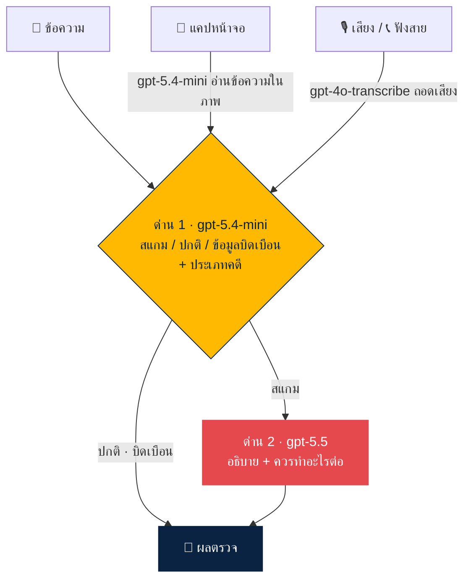

- 🔐 **key อยู่ฝั่ง server เท่านั้น** (`app/api/*`) เบราว์เซอร์ไม่เคยเห็น
- 💰 **สองด่านประหยัดเงิน**: ทุกข้อความใช้โมเดลถูก เฉพาะสแกมจึงส่งต่อโมเดลแพง
- 🧾 **JSON schema แบบ strict**: โมเดลตอบโครงสร้างเดิมทุกครั้ง โค้ดอ่านต่อได้ไม่พัง
- 🙈 **ไม่เก็บข้อความ ภาพ หรือเสียง** และไม่ log เนื้อหา

> [!TIP]
> **อยากรู้ลึกทุกชิ้น** — stack, เครื่องมือ, ตรรกะสองด่าน, JSON schema, การถอดเสียง, PWA, หลักการ **C2PA** และการตรวจภาพจาก AI,
> วิธีทดสอบด้วย curl และสูตรเอาไปสร้างแอปของตัวเอง → อ่าน **[คู่มือนักพัฒนา `webapp/README.md`](webapp/README.md)**

<details>
<summary>📁 <b>โครงไฟล์สำคัญ</b></summary>

<br>

```text
webapp/
├── lib/scam.ts                 ← 🧠 prompt, schema, เรียกโมเดล (ฝั่ง server)
├── lib/samples.ts              ← 🗂️ 14 ประเภทคดี + ข้อความตัวอย่าง
├── app/api/check/route.ts      ← POST {text} → ผลตรวจ
├── app/api/read-image/route.ts ← POST รูป → ข้อความ
├── app/api/transcribe/route.ts ← POST เสียง → ข้อความ
├── app/Checker.tsx             ← หน้าจอหลัก + bottom sheet ผลตรวจ
├── app/LiveListen.tsx          ← โหมดฟังสาย
├── app/manifest.ts             ← ตั้งค่า PWA (ชื่อแอป ไอคอน แชร์เข้าแอป)
├── .env.example                ← แม่แบบ .env.local
└── deploy-azure.sh             ← deploy ขึ้น App Service แผนฟรี
```

</details>

---

## 🗂️ 14 ประเภทคดีออนไลน์

แอปจัดประเภทตาม **ระบบแจ้งความออนไลน์** (thaipoliceonline.go.th) — เอาไปเลือกประเภทตอนแจ้งความได้เลย
สถิติ 1 มี.ค. 2565 – 10 พ.ย. 2566 · รวม **361,655 คดี**

<table>
<tr>
<td align="center" width="25%"><br><b>1 · ซื้อขายสินค้า</b><br><sub>ไม่เป็นขบวนการ · 145,748</sub></td>
<td align="center" width="25%"><br><b>2 · โอนเงินเพื่อทำงาน</b><br><sub>47,996</sub></td>
<td align="center" width="25%">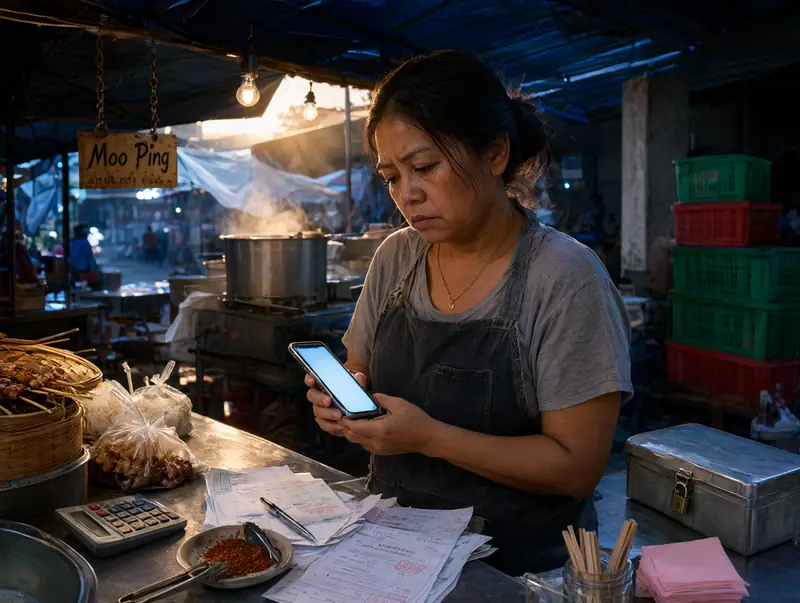<br><b>3 · หลอกให้กู้เงิน</b><br><sub>40,251</sub></td>
<td align="center" width="25%"><br><b>4 · หลอกลงทุน</b><br><sub>29,808</sub></td>
</tr>
<tr>
<td align="center"><br><b>5 · คอลเซ็นเตอร์</b><br><sub>25,938</sub></td>
<td align="center">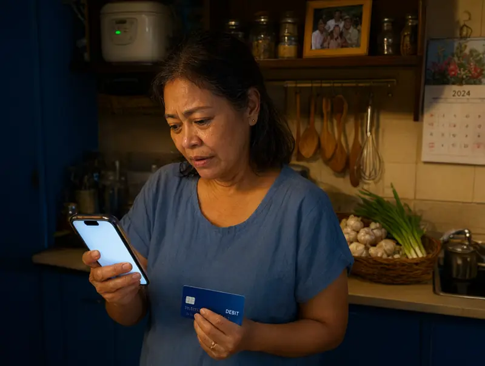<br><b>6 · แอบอ้างยืมเงิน</b><br><sub>13,987</sub></td>
<td align="center"><br><b>7 · โอนเพื่อรับรางวัล</b><br><sub>11,234</sub></td>
<td align="center"><br><b>8 · แอปควบคุมเครื่อง</b><br><sub>9,610</sub></td>
</tr>
<tr>
<td align="center"><br><b>9 · ซื้อขายสินค้า</b><br><sub>เป็นขบวนการ · 8,504</sub></td>
<td align="center"><br><b>10 · เจาะระบบ/บัญชี</b><br><sub>3,805</sub></td>
<td align="center"><br><b>11 · แชร์ลูกโซ่</b><br><sub>3,196</sub></td>
<td align="center"><br><b>12 · หลอกให้รัก</b><br><sub>2,931</sub></td>
</tr>
<tr>
<td align="center"><br><b>13 · สินทรัพย์ดิจิทัล</b><br><sub>2,073</sub></td>
<td align="center">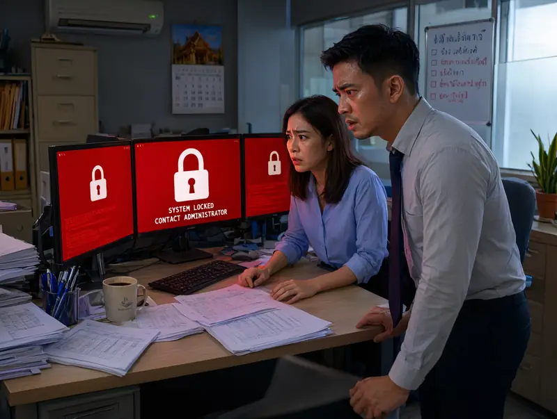<br><b>14 · Ransomware</b><br><sub>115</sub></td>
<td colspan="2" align="center">📞 <b>โดนหลอกแล้ว?</b><br>โทร <b>1441</b> สายด่วนตำรวจไซเบอร์<br>แจ้งความที่ <a href="https://thaipoliceonline.go.th">thaipoliceonline.go.th</a></td>
</tr>
</table>

---

## 📸 ภาพหน้าจอตัวอย่าง ไว้ลองอัปโหลด

หน้าจอจำลองจากแชต โพสต์ คลิปสั้น และ SMS ที่มิจฉาชีพใช้ (แต่งขึ้นทั้งหมด ไม่ใช่หน้าตาแอปจริง)
บนคอมฯ กดภาพในแผง **ภาพตัวอย่าง** ด้านขวาของแอปได้เลย (ไอคอนมุมขวาบน = ดูเต็มจอ) หรือลากไฟล์ภาพไปวางที่ปุ่ม **แคปหน้าจอ** · บนมือถือ คลิกภาพด้านล่าง → บันทึกลงเครื่อง → อัปโหลดผ่านปุ่ม **📸 แคปหน้าจอ**

<table>
<tr>
<td align="center" width="33%"><a href="webapp/public/samples/screens/01-chat-line.webp">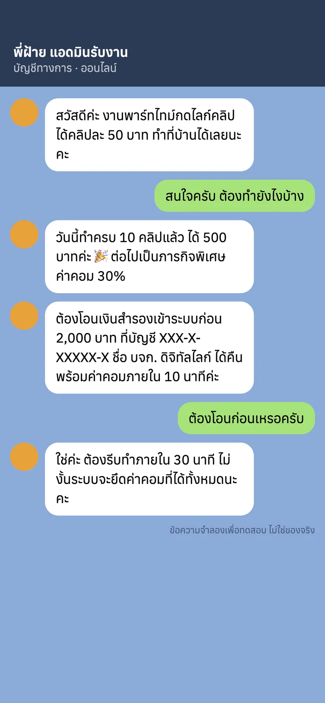</a><br><b>แชตงานกดไลก์</b><br><sub>แชต · โอนเงินเพื่อทำงาน</sub></td>
<td align="center" width="33%"><a href="webapp/public/samples/screens/02-post-facebook.webp">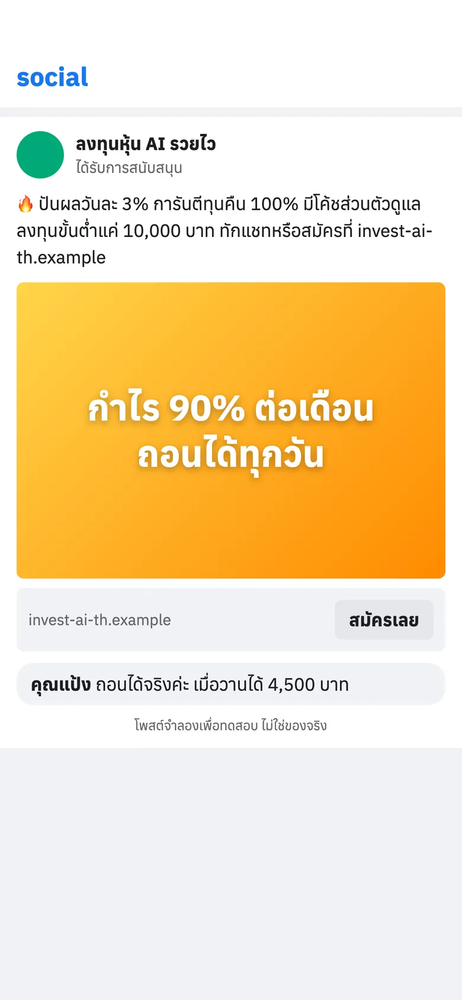</a><br><b>โฆษณาลงทุน</b><br><sub>โพสต์โซเชียล · หลอกลงทุน</sub></td>
<td align="center" width="33%"><a href="webapp/public/samples/screens/03-video-crypto.webp">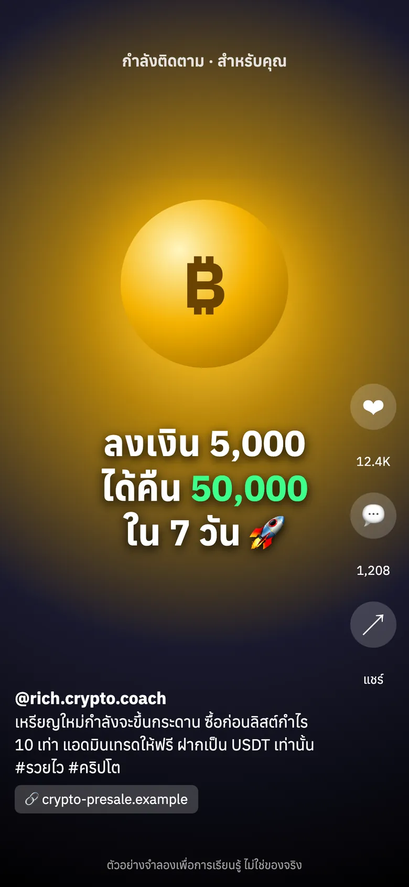</a><br><b>คลิปคริปโตรวยไว</b><br><sub>คลิปสั้น · สินทรัพย์ดิจิทัล</sub></td>
</tr>
<tr>
<td align="center"><a href="webapp/public/samples/screens/04-sms-parcel.webp">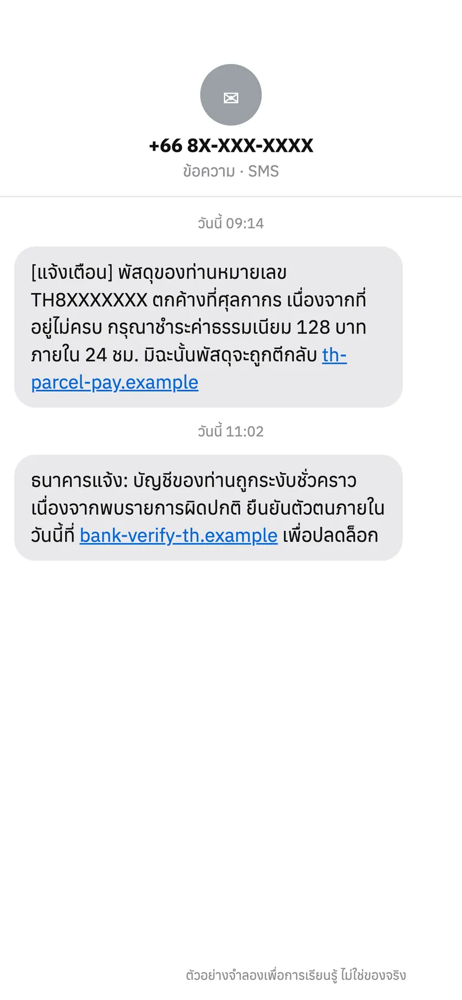</a><br><b>SMS พัสดุ/ธนาคาร</b><br><sub>SMS · ลิงก์หลอกกรอกข้อมูล</sub></td>
<td align="center"><a href="webapp/public/samples/screens/05-market-iphone.webp">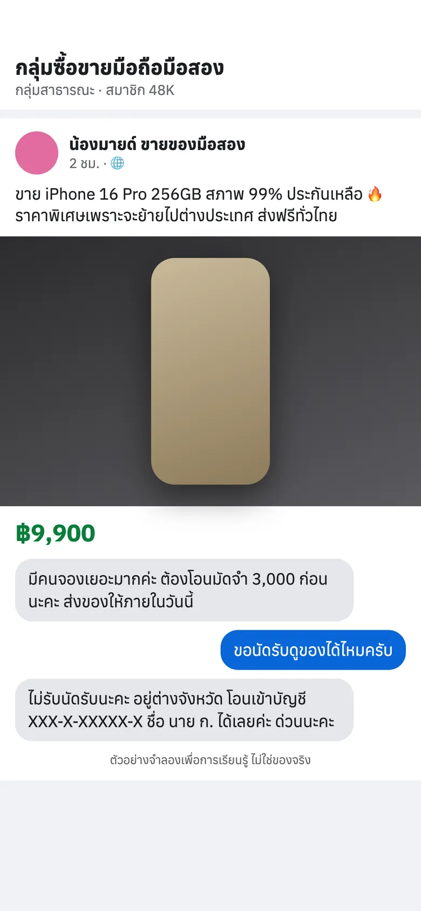</a><br><b>ขายไอโฟนมัดจำ</b><br><sub>กลุ่มซื้อขาย · ซื้อขายสินค้า</sub></td>
<td align="center"><a href="webapp/public/samples/screens/06-chat-romance.webp">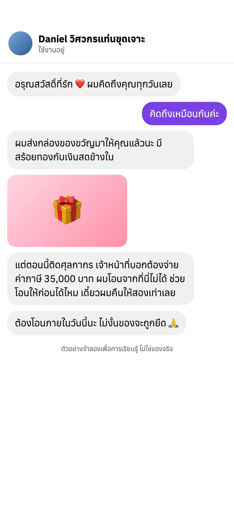</a><br><b>หลอกให้รัก</b><br><sub>แชต · หลอกให้รักแล้วโอนเงิน</sub></td>
</tr>
</table>

**ภาพจาก AI สำหรับลองตรวจที่มาด้วย C2PA** — ต้องอัปโหลดไฟล์ต้นฉบับ (ดาวน์โหลดจากปุ่ม *Download raw file* ของ GitHub) ถ้าส่งผ่านแชตหรือแคปจอ ข้อมูล C2PA จะหายไป

<table>
<tr>
<td align="center" width="33%"><a href="webapp/public/samples/c2pa/01-ai-signed.jpg"></a><br><b>ภาพ AI มี C2PA</b><br><sub>ควรขึ้น "สร้างด้วย AI"</sub></td>
<td align="center" width="33%"><a href="webapp/public/samples/c2pa/02-ai-stripped.jpg"></a><br><b>ภาพเดียวกัน ลบ C2PA</b><br><sub>ควรขึ้น "ไม่พบ C2PA"</sub></td>
<td align="center" width="33%"><a href="webapp/public/samples/c2pa/03-ai-tampered.jpg"></a><br><b>แก้ภาพหลังเซ็น</b><br><sub>ควรขึ้น "ลายเซ็นใช้ไม่ได้"</sub></td>
</tr>
</table>

---

## 📝 ก่อนวันอบรม (pre-work)

> [!WARNING]
> โครงการนี้ **ไม่มีผู้สนับสนุนค่า Azure** ผู้เรียนสร้างบัญชีและ resource เอง (ทีมละบัญชีก็พอ)

- [ ] **สมัคร Azure free account** ที่ https://azure.microsoft.com/free — ต้องมีบัญชี Microsoft หรือ GitHub, เบอร์โทร และบัตรเครดิต/เดบิตที่ไม่ใช่แบบเติมเงิน (อาจกันวงเงิน ~1 ดอลลาร์ชั่วคราวแล้วคืน)
- [ ] **สร้าง project ใน Microsoft Foundry** ที่ https://ai.azure.com — ตั้งใน resource group แยก จะลบทิ้งง่ายหลังอบรม
- [ ] **Deploy โมเดล** แบบ Global Standard และตั้งชื่อ deployment ให้ตรงกับชื่อโมเดล

  | deployment | ใช้ทำอะไร | |
  |---|---|---|
  | `gpt-5.4-mini` | คัดกรอง + อ่านแคปหน้าจอ | **ต้องมี** |
  | `gpt-5.5` | วิเคราะห์ละเอียด (ไม่มีโควตา → ใช้ `gpt-5.4` แล้วแก้ `DEEP_MODEL`) | **ต้องมี** |
  | `gpt-4o-transcribe` | ถอดเสียง · Preview · มีเฉพาะบาง region เช่น East US 2, Sweden Central | ไม่บังคับ |

- [ ] **คัดลอก key และ endpoint** จากหน้า *Keys and Endpoint* — ชื่อ resource คือส่วนหน้าของ endpoint เช่น `https://my-scam-lab.openai.azure.com/` → `my-scam-lab`
- [ ] **ตั้งงบและแจ้งเตือน** ที่ Cost Management → Budgets

---

## 💸 กันไม่ให้เสียเงิน

> [!CAUTION]
> **key ที่หลุดคือเงินในบัตรของคุณ** — ห้าม commit, ห้ามวางในแชต, **ห้ามตั้งพอร์ต 3000 ใน Codespaces เป็น Public**
> (`.env.local` ถูกกันไม่ให้ commit ไว้แล้ว)

- ✅ **Free account ไม่ตัดเงินเอง** — ครบ 30 วันหรือเครดิตหมด subscription จะถูกปิด ถ้าคุณไม่กด Upgrade
- 🚫 **อย่ากด Upgrade to pay-as-you-go** ถ้ายังไม่ตั้งใจจ่ายเงินจริง
- 🚫 **App Service: อย่าเปิด Always On และอย่ากด Scale up** แผนฟรีจะกลายเป็นแผนเสียเงิน
- 🧹 **หลังอบรม** ลบ resource group ของแล็บ: Azure portal → Resource groups → Delete resource group
- ⏸️ **หยุด Codespace** ที่ https://github.com/codespaces เมื่อเลิกใช้

---

<div align="center">

**วิทยากร** นายเอกพงษ์ ขัติยะ · กรรมการผู้จัดการ บริษัท โค้ดดีวา จำกัด<br>
Microsoft Partner · Microsoft AI Cloud Partner Program

<sub>ข้อความตัวอย่างทั้งหมดแต่งขึ้นเพื่อการสอน เบอร์โทร ลิงก์ และเลขบัญชีเป็นของปลอม · ภาพคนในแอปสร้างด้วย AI ไม่ใช่บุคคลจริง</sub>

</div>

---

## English

<details>
<summary><b>ScamAlert in English — click to expand</b></summary>

<br>

**ScamAlert** is a Next.js PWA that checks Thai scam messages and calls with GPT models on Microsoft Foundry:
paste text, upload a screenshot (LINE, Facebook, TikTok…), upload audio, or listen to a call on speaker from a second device.
Results name the police online-report case type (14 types) and what to do next. Built for Online Workshop 2 of the
Thailand Cyber & Digital Innovation Challenge, Saturday 28 November 2026, online via Google Meet.

**Pre-work (your own Azure, no sponsor):** create an Azure free account → a Microsoft Foundry project in its own resource
group → deploy `gpt-5.4-mini` and `gpt-5.5` (or `gpt-5.4`) as Global Standard, optionally `gpt-4o-transcribe` for audio
(preview, only some regions) → copy the key and resource name → set a budget.

**On the day:**

1. Click **Open in GitHub Codespaces** above → Create codespace (2–3 min) → *Trust Folder & Continue*
2. `cd webapp && cp .env.example .env.local`, put `FOUNDRY_API_KEY` and `FOUNDRY_RESOURCE` in `.env.local`
3. `npm run dev` — the app opens on port 3000
4. Last mission: `az login --use-device-code` then `APP_NAME=scam-check-<team> ./deploy-azure.sh` (free App Service tier; if F1 quota is 0, add `LOCATION=southeastasia SKU=B1`, a paid plan of about USD 13/month)

**Avoiding charges:** a free account never charges you on its own; don't press Upgrade; never commit your key or make
port 3000 Public; don't enable Always On or scale up App Service; delete the resource group and stop the Codespace afterwards.

This README is the lab guide; the slides follow the same 11 missions. App details: [`webapp/README.md`](webapp/README.md)

</details>
