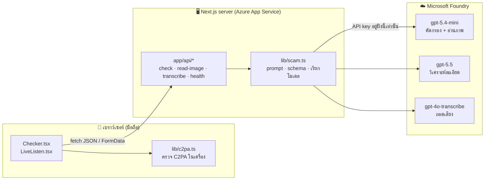
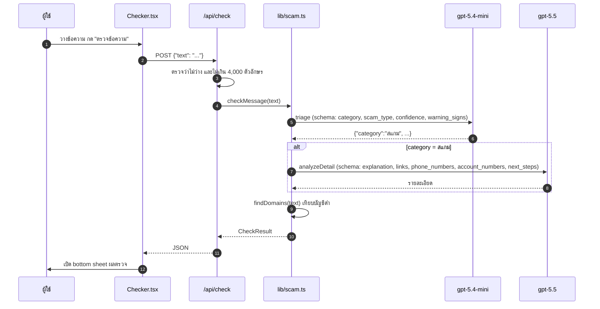
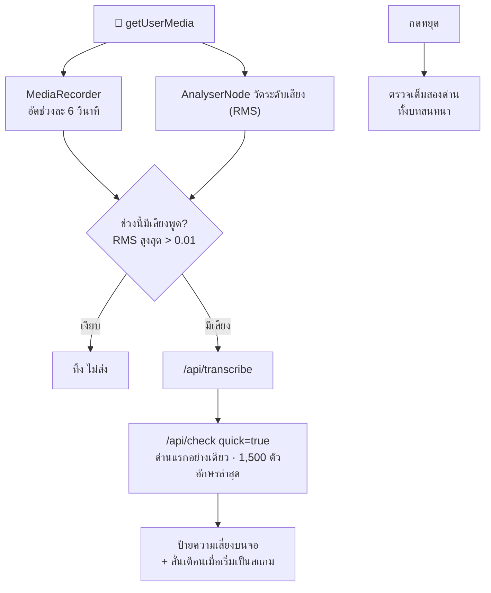
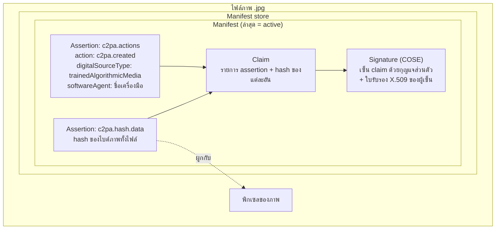

# ScamAlert · คู่มือนักพัฒนา

คู่มือนี้อธิบายทุกชิ้นของแอป ตั้งแต่ stack, เครื่องมือ, ตรรกะ, การไหลของข้อมูล จนถึงการตรวจที่มาของภาพด้วย **C2PA**
เขียนให้คนที่เพิ่งเริ่มเขียนเว็บอ่านตามได้ทีละขั้น และเอาไปสร้างแอปของตัวเองต่อได้

> คู่มือสำหรับผู้เรียน (ภารกิจ 11 ขั้น) อยู่ที่ [README หลัก](../README.md) — ไฟล์นี้คือ "ข้างในทำงานยังไง"

## สารบัญ

1. [ภาพรวมใน 1 นาที](#1-ภาพรวมใน-1-นาที)
2. [Stack และเหตุผลที่เลือก](#2-stack-และเหตุผลที่เลือก)
3. [เครื่องมือที่ใช้ทำงาน](#3-เครื่องมือที่ใช้ทำงาน)
4. [โครงไฟล์](#4-โครงไฟล์)
5. [ข้อมูลไหลยังไง (ทีละช่องทาง)](#5-ข้อมูลไหลยังไง-ทีละช่องทาง)
6. [ตรรกะฝั่ง server ทีละชิ้น](#6-ตรรกะฝั่ง-server-ทีละชิ้น)
7. [ฝั่งหน้าจอและ PWA](#7-ฝั่งหน้าจอและ-pwa)
8. [ตรวจภาพจาก AI และ C2PA](#8-ตรวจภาพจาก-ai-และ-c2pa)
9. [รันและทดสอบ](#9-รันและทดสอบ)
10. [Deploy ขึ้น Azure](#10-deploy-ขึ้น-azure)
11. [ติดตั้งลงมือถือ และขึ้น Store](#11-ติดตั้งลงมือถือ-และขึ้น-store)
12. [ค่าใช้จ่าย ความปลอดภัย และ PDPA](#12-ค่าใช้จ่าย-ความปลอดภัย-และ-pdpa)
13. [เอาไปประยุกต์](#13-เอาไปประยุกต์)
14. [คำศัพท์](#14-คำศัพท์)

---

## 1. ภาพรวมใน 1 นาที

ผู้ใช้ส่งของที่น่าสงสัยเข้ามา 4 ทาง แอปแปลงทุกอย่างเป็น **ข้อความ** ก่อน แล้วส่งข้อความนั้นเข้า **ตรรกะสองด่าน** ชุดเดียวกัน

| ช่องทาง | แปลงเป็นข้อความด้วย | ไฟล์ที่เกี่ยว |
|---|---|---|
| 💬 วางข้อความ / แชร์เข้าแอป | ไม่ต้องแปลง | `app/Checker.tsx`, `app/page.tsx` |
| 📸 แคปหน้าจอ | โมเดลที่อ่านภาพได้ (`gpt-5.4-mini`) ถอดข้อความในภาพ | `app/api/read-image/route.ts` |
| 🎙️ ไฟล์เสียง | `gpt-4o-transcribe` ถอดเสียง | `app/api/transcribe/route.ts` |
| 📞 ฟังสายสด | อัดทีละ 6 วินาที แล้วถอดเสียงทีละช่วง | `app/LiveListen.tsx` |



หลักการสำคัญ 4 ข้อ ที่เอาไปใช้กับแอป AI ตัวไหนก็ได้

- 🔐 **key อยู่ฝั่ง server เท่านั้น** เบราว์เซอร์เรียก `/api/*` ของเราเอง ไม่เคยเรียก Azure ตรง
- 💰 **สองด่าน** ทุกข้อความผ่านโมเดลถูกก่อน เฉพาะที่เป็นสแกมจึงส่งต่อโมเดลแพง
- 🧾 **Structured output** บังคับให้โมเดลตอบ JSON ตาม schema ทุกครั้ง โค้ดอ่านต่อได้ไม่พัง
- 🙈 **ไม่เก็บอะไร** ไม่บันทึกข้อความ ภาพ หรือเสียง และไม่ log เนื้อหา

---

## 2. Stack และเหตุผลที่เลือก

| ชั้น | ใช้อะไร (รุ่นใน `package.json`) | ทำไม |
|---|---|---|
| ภาษา | **TypeScript** 7 | จับชนิดข้อมูลผิดตั้งแต่ตอนเขียน เช่น ลืม field ใน JSON ที่โมเดลตอบ |
| เฟรมเวิร์ก | **Next.js 16** (App Router, Turbopack) | หน้าเว็บ (React) กับ API ฝั่ง server อยู่ในโปรเจกต์เดียว deploy ครั้งเดียว |
| UI | **React 19** + CSS ล้วน (`app/globals.css`) | ไม่ใช้ UI library ให้อ่านโค้ดเข้าใจง่าย และไฟล์เล็ก |
| ฟอนต์ | **Anuphan** ผ่าน `next/font/google` | ฟอนต์ไทยไม่มีหัว ดูทันสมัย next/font เก็บไฟล์ฟอนต์ไว้ในแอปตอน build |
| เรียกโมเดล | **openai** SDK 7 (Responses API) | Microsoft Foundry รองรับ endpoint แบบ OpenAI v1 ใช้ SDK ตัวเดียวกับ OpenAI ได้เลย |
| โมเดล | **Microsoft Foundry**: `gpt-5.4-mini`, `gpt-5.5`, `gpt-4o-transcribe` · ทางเลือก Claude ผ่าน `@anthropic-ai/foundry-sdk` | ข้อมูลอยู่ใน Azure, คิดเงินตามใช้, ตั้งงบและปิด key ได้ |
| ตรวจที่มาภาพ | **@contentauth/c2pa-web** 0.17 (WebAssembly) | ไลบรารีทางการของ Content Authenticity Initiative รันในเบราว์เซอร์ ภาพไม่ต้องออกจากเครื่อง |
| แอปมือถือ | **PWA** (`app/manifest.ts`, `public/sw.js`) | เว็บเดียวติดตั้งลงมือถือได้ ไม่ต้องเขียนแอป Android/iOS แยก |
| Hosting | **Azure App Service** (Linux, Node 22) | รัน `server.js` ของ Next.js แบบ standalone ได้ตรง ๆ มี HTTPS ให้ (ไมค์ต้องใช้ HTTPS) |
| สภาพแวดล้อม | **GitHub Codespaces** (`.devcontainer/`) | ผู้เรียนเปิดเบราว์เซอร์แล้วได้เครื่องที่มี Node 22 + Azure CLI ครบ ไม่ต้องลงอะไร |

> [!TIP]
> Next.js รุ่นนี้ใหม่กว่าที่บทความส่วนใหญ่บนเว็บเขียนไว้ ถ้าโค้ดตัวอย่างจากที่อื่นใช้ไม่ได้ ให้ดูเอกสารที่มากับแพ็กเกจใน
> `node_modules/next/dist/docs/` เช่น `searchParams` ใน `page.tsx` เป็น `Promise` ต้อง `await` ก่อนใช้

---

## 3. เครื่องมือที่ใช้ทำงาน

| เครื่องมือ | ใช้ทำอะไรในโปรเจกต์นี้ |
|---|---|
| **Node.js 22 + npm** | รัน dev server, build, ติดตั้งแพ็กเกจ (`npm ci` ติดตั้งตาม `package-lock.json` เป๊ะ ๆ) |
| **VS Code / Codespaces** | เขียนโค้ด, Terminal, แท็บ Ports เปิดแอปบนพอร์ต 3000 |
| **Microsoft Foundry portal** (ai.azure.com) | deploy โมเดล, คัดลอก API key และชื่อ resource |
| **Azure CLI (`az`)** | สร้าง App Service และอัปโหลดแอปใน `deploy-azure.sh` |
| **Chrome DevTools** | แท็บ Network ดู request ไป `/api/*`, โหมดมือถือ (Toggle device toolbar), แท็บ Application ดู manifest และ service worker |
| **curl** | ยิง API ตรง ๆ เพื่อแยกว่าปัญหาอยู่ที่หน้าจอหรือฝั่ง server (ดู [ข้อ 9](#9-รันและทดสอบ)) |
| **openssl + @contentauth/c2pa-node** | สร้างใบรับรองทดสอบและเซ็นภาพตัวอย่าง C2PA (`scripts/make-c2pa-samples.mjs`) |
| **[contentcredentials.org/verify](https://contentcredentials.org/verify)** | เว็บทางการไว้เทียบผลตรวจ C2PA กับของแอปเรา |
| **SparkThai Model Studio** | สร้างภาพประกอบ (qwen-image-3.0-pro) และเสียงสังเคราะห์ภาษาไทยของคลิปตัวอย่าง |
| **[PWABuilder](https://www.pwabuilder.com)** | แพ็ก PWA เป็นแอปขึ้น Google Play / App Store / Microsoft Store |

---

## 4. โครงไฟล์

```text
webapp/
├── lib/
│   ├── scam.ts              🧠 หัวใจของแอป: prompt, JSON schema, เรียกโมเดล, ถอดเสียง, บัญชีดำโดเมน (server เท่านั้น)
│   ├── claude.ts            🔀 ทางเลือก: เรียก Claude บน Foundry เมื่อ AI_PROVIDER=claude (server เท่านั้น)
│   ├── c2pa.ts              🔏 อ่าน Content Credentials ของภาพ (เบราว์เซอร์เท่านั้น)
│   ├── samples.ts           🗂️ 14 ประเภทคดี, จำนวนคดี, ข้อความ/ภาพ/คลิปตัวอย่าง
│   └── icons.ts             🎨 icon pack ต้นฉบับ (npm run icons → design/icons/)
├── app/
│   ├── layout.tsx           ฟอนต์, metadata, theme color, ลงทะเบียน service worker
│   ├── page.tsx             หน้าแรก (server component) รับข้อความที่ "แชร์" เข้ามาทาง ?text=
│   ├── Checker.tsx          หน้าจอหลัก: ช่องข้อความ, ตัวอย่าง, ปุ่มอัปโหลด, sheet ผลตรวจ, popup key
│   ├── LiveListen.tsx       หน้าจอฟังสายสด
│   ├── TypesGallery.tsx     sheet ตัวอย่างทั้งหมด (ข้อความ / ภาพหน้าจอ / คลิปเสียง)
│   ├── Icon.tsx             <Icon name="..."/> ดึงจาก lib/icons.ts
│   ├── SwRegister.tsx       register /sw.js
│   ├── manifest.ts          web app manifest (ชื่อแอป, ไอคอน, share_target)
│   ├── globals.css          สไตล์ทั้งหมด (โหมดมืด, layout หน้าจอเดียว)
│   └── api/
│       ├── check/route.ts       POST {text, quick?} → ผลตรวจ
│       ├── read-image/route.ts  POST รูป → {text}
│       ├── transcribe/route.ts  POST เสียง → {text}
│       └── health/route.ts      GET → {ok} หรือ {error} (เช็ก key ตอนเปิดแอป)
├── public/
│   ├── sw.js                service worker ขั้นต่ำ
│   ├── c2pa/                WASM ของ c2pa-web (คัดลอกอัตโนมัติ ไม่อยู่ใน git)
│   ├── img/                 ภาพ hero, ภาพประกอบ 14 ประเภทคดี
│   └── samples/             screens/ (แคปจอจำลอง) · c2pa/ (ภาพ AI) · audio/ (คลิปเสียงจำลอง)
├── scripts/
│   ├── copy-c2pa-wasm.mjs   รันเองก่อน npm run dev / build
│   ├── make-c2pa-samples.mjs  สร้างภาพตัวอย่าง C2PA 3 แบบ (รันครั้งเดียว)
│   └── export-icons.mts     ส่งออกไอคอนเป็น .svg
├── design/                  โลโก้, ไอคอน, ต้นฉบับ HTML ของแคปจอจำลอง (fixtures/)
├── next.config.ts           output standalone, เลขรุ่น + commit ที่ footer, security headers
├── .env.example             แม่แบบ .env.local
└── deploy-azure.sh          build + deploy ขึ้น App Service ในคำสั่งเดียว
```

กฎง่าย ๆ ที่ใช้แบ่งไฟล์: **อะไรที่แตะ key อยู่ใน `lib/scam.ts` และถูก import จาก `app/api/*` เท่านั้น**
ไฟล์ที่ขึ้นต้นด้วย `'use client'` (เช่น `Checker.tsx`) รันในเบราว์เซอร์ ห้าม import `lib/scam.ts` มาเรียกตรง ๆ
(import ได้แค่ `type` เช่น `import type { CheckResult } from '@/lib/scam'` ซึ่งหายไปตอน build)

---

## 5. ข้อมูลไหลยังไง (ทีละช่องทาง)

### 5.1 ข้อความ



### 5.2 แคปหน้าจอ

1. ผู้ใช้เลือกรูป (หรือแตะภาพตัวอย่าง) → `uploadImage(file)` ใน `Checker.tsx`
2. **เริ่มตรวจ C2PA จากไฟล์ต้นฉบับทันที** (`readC2pa(file)`) ในเบราว์เซอร์ — ต้องทำก่อนย่อภาพ เพราะการวาดลง canvas แล้วบันทึกใหม่จะทิ้งข้อมูล C2PA
3. ย่อภาพในเครื่องด้วย `shrinkImage()` ให้กว้างไม่เกิน 1080 px แล้วบีบเป็น JPEG คุณภาพ 0.85 (แคปจอ iPhone หลาย MB เหลือราว 200–500 KB)
4. `POST /api/read-image` (FormData ชื่อ `image`) → route แปลงเป็น data URL base64 → `readScreenshot()` ส่งให้โมเดลอ่าน
5. โมเดลตอบ `{readable, source, lines}` → server ต่อเป็นข้อความ `"[แคปหน้าจอ LINE]\nชื่อ: ข้อความ..."`
6. ข้อความไปลงช่องให้ผู้ใช้เห็น แล้วเรียก `check(text, c2paInfo)` ต่อเหมือนข้อ 5.1 ผล C2PA แสดงในหัวข้อ "ที่มาของภาพ"
7. ถ้าภาพไม่มีข้อความเลย (เช่น ภาพวิว) แต่มี C2PA แอปยังเปิด sheet บอกที่มาของภาพให้

### 5.3 ไฟล์เสียง

1. `uploadAudio(file)` เช็กขนาดไม่เกิน 25 MB (เพดานของ Azure) ในเบราว์เซอร์ก่อน
2. `POST /api/transcribe` (FormData ชื่อ `audio`) → route ตรวจชนิดไฟล์ แล้ว **ตั้งชื่อไฟล์ใหม่เป็น ASCII** เช่น `audio.m4a` (Azure ไม่รับชื่อไฟล์ภาษาไทย)
3. `transcribe(file)` ส่ง `language: 'th'` → ได้ข้อความ → ลงช่อง → ตรวจต่อเหมือนข้อ 5.1

### 5.4 ฟังสายสด



รายละเอียดที่ควรรู้ (ทั้งหมดอยู่ใน `app/LiveListen.tsx`)

- **ทำไมอัดเป็นช่วง** — แต่ละช่วงเป็นไฟล์เสียงสมบูรณ์ ส่งถอดได้ทันที ไม่ต้องรอจบสาย
- **ทำไมไม่ส่งช่วงที่เงียบ** — โมเดลถอดเสียงมักแต่งคำขึ้นมาเองเมื่อเจอความเงียบ และเสียเงินฟรี
- **คิวลำดับ** — `queue.current = queue.current.then(...)` ทำให้ถอดเสียงเรียงตามลำดับเวลาแม้เน็ตช้า
- **ไม่ยิงซ้อน** — `checking.current` กันไม่ให้ quick check รอบใหม่ยิงขณะรอบเก่ายังไม่เสร็จ
- **Wake Lock** — กันจอดับระหว่างฟัง · **`navigator.vibrate`** — สั่นเตือนครั้งแรกที่ผลเปลี่ยนเป็นสแกม
- **ทำไมต้องเป็นเครื่องที่สอง** — ระหว่างโทร Android และ iOS ปิดไมค์ของแอปอื่น (Android ส่งเสียงเงียบให้, iOS ระงับไมค์ของหน้าเว็บ)
  แอปจับได้จาก `track.muted` หรือเงียบเกิน 10 วินาที แล้วขึ้นคำแนะนำให้เปิดลำโพงวางใกล้อีกเครื่อง
- ไมค์ใช้ได้เฉพาะบน `https://` หรือ `localhost`

---

## 6. ตรรกะฝั่ง server ทีละชิ้น

ทุกอย่างในหัวข้อนี้อยู่ใน [`lib/scam.ts`](lib/scam.ts)

### 6.1 ตั้งค่าและ client

```ts
client ??= new OpenAI({
  apiKey,
  baseURL: process.env.FOUNDRY_BASE_URL || `https://${resource}.openai.azure.com/openai/v1/`,
})
```

- อ่าน `FOUNDRY_API_KEY` และ `FOUNDRY_RESOURCE` จาก environment (ไฟล์ `.env.local` ตอนรันในเครื่อง, App settings บน Azure)
- ใส่แค่ **ชื่อ resource** โค้ดต่อ URL เต็มให้เอง — ถ้าใส่ URL เต็มลงไปจะกลายเป็น `https://https://...`
- `??=` สร้าง client ครั้งเดียวแล้วใช้ซ้ำ
- ไม่มีค่า → โยน `Error('not_configured')` ซึ่งหน้าเว็บแปลเป็น popup "ยังไม่ได้ตั้งค่า"
- `FOUNDRY_BASE_URL` มีไว้ชี้ไป server จำลองตอนทดสอบเท่านั้น

| ตัวแปร | ค่าเริ่มต้น | ใช้ทำอะไร |
|---|---|---|
| `FOUNDRY_API_KEY` | — | key ของ Foundry resource (ต้องมี) |
| `FOUNDRY_RESOURCE` | — | ชื่อ resource เช่น `my-foundry` (ต้องมี) |
| `TRIAGE_MODEL` | `gpt-5.4-mini` | ชื่อ deployment ด่านคัดกรอง |
| `DEEP_MODEL` | `gpt-5.5` | ชื่อ deployment ด่านวิเคราะห์ละเอียด |
| `VISION_MODEL` | ใช้ `TRIAGE_MODEL` | ชื่อ deployment ที่อ่านภาพ |
| `TRANSCRIBE_MODEL` | `gpt-4o-transcribe` | ชื่อ deployment ถอดเสียง |
| `AI_PROVIDER` | (ว่าง = GPT) | ตั้งเป็น `claude` เพื่อใช้ Claude แทน GPT ดู [ข้อ 6.9](#69-ทางเลือก-ใช้-claude-บน-microsoft-foundry-แทน-gpt) |

### 6.2 สองด่าน: ถูกก่อน แพงทีหลัง

```ts
export async function checkMessage(text: string, quick = false): Promise<CheckResult> {
  const t = await triage(text)                                   // ด่าน 1: ทุกข้อความ
  const detail = !quick && t.category === 'สแกม' ? await analyzeDetail(text) : null  // ด่าน 2: เฉพาะสแกม
  return { ...t, detail, domains: findDomains(text) }
}
```

ข้อความส่วนใหญ่ที่คนส่งมาตรวจเป็นเรื่องปกติ ถ้าส่งทุกข้อความให้โมเดลใหญ่ จ่ายแพงโดยไม่จำเป็น
รูปแบบนี้เรียกว่า **model cascade / routing** ใช้ได้กับงานคัดแยกแทบทุกแบบ เช่น คัดอีเมล ticket หรือคอมเมนต์

| | ด่าน 1 `triage` | ด่าน 2 `analyzeDetail` |
|---|---|---|
| โมเดล | `gpt-5.4-mini` (ถูก เร็ว) | `gpt-5.5` (แพง ละเอียด) |
| `reasoning.effort` | `low` | `medium` |
| ได้อะไร | ประเภท, ประเภทคดี, ความมั่นใจ, สัญญาณเตือน | คำอธิบาย, ลิงก์/เบอร์/เลขบัญชีที่พบ, ควรทำอะไรต่อ |
| เรียกเมื่อ | ทุกครั้ง | เฉพาะ `category = สแกม` และไม่ใช่โหมด `quick` |

### 6.3 Structured output: บังคับรูป JSON

```ts
const TRIAGE_FORMAT = {
  type: 'json_schema', name: 'triage', strict: true,
  schema: {
    type: 'object',
    properties: {
      category: { type: 'string', enum: ['สแกม', 'ปกติ', 'ข้อมูลบิดเบือน'] },
      scam_type: { type: 'string', enum: [...SCAM_TYPES, NOT_A_CASE] },   // 14 ประเภทคดี + "ไม่เข้าข่าย"
      confidence: { type: 'number' },
      warning_signs: { type: 'array', items: { type: 'string' } },
    },
    required: ['category', 'scam_type', 'confidence', 'warning_signs'],
    additionalProperties: false,
  },
}
```

- `strict: true` = โมเดล **ต้อง** ตอบตาม schema โค้ดจึง `JSON.parse(r.output_text)` ได้เลยโดยไม่ต้องเดาว่าจะมี field ไหน
- `enum` ของ `scam_type` มาจาก `lib/samples.ts` โมเดลเลือกได้เฉพาะชื่อประเภทคดีที่ระบบแจ้งความออนไลน์ใช้จริง ไม่แต่งชื่อใหม่
- เพิ่ม/ลด ประเภท = แก้ `CASES` ใน `lib/samples.ts` ที่เดียว schema และแกลเลอรีเปลี่ยนตาม

### 6.4 Prompt

- **`TRIAGE_PROMPT`** นิยาม 3 หมวดให้ชัด แล้วอธิบายประเภทคดีที่คนมักสับสน (เช่น คอลเซ็นเตอร์ กับ แอบอ้างเป็นคนรู้จัก)
  เมื่อโมเดลจัดผิด วิธีแก้ที่ได้ผลที่สุดคือเพิ่มบรรทัดนิยามแบบนี้ ไม่ใช่เพิ่มตัวอย่างยาว ๆ
- **`DETAIL_PROMPT`** สั่งให้อธิบายแบบคนทั่วไปเข้าใจ และมี **guardrail**:
  "ช่องทางแจ้งความทางการมีแค่สายด่วน 1441 และ thaipoliceonline.go.th ห้ามแต่งช่องทางอื่นขึ้นเอง" —
  แอปเตือนภัยที่แต่งเบอร์ติดต่อปลอมขึ้นมาเองอันตรายกว่าไม่มีแอป
- **`SCREEN_PROMPT`** บอกวิธีถอดข้อความแยกตามชนิดหน้าจอ (แชต / โพสต์ / TikTok / อีเมล) และสั่ง **ห้ามแปล ห้ามสรุป ห้ามแก้คำผิด**
  เพราะคำสะกดผิดและลิงก์แปลก ๆ คือหลักฐานของสแกม

### 6.5 ดึงโดเมนและบัญชีดำ

```ts
const found = text.toLowerCase().match(/\b(?:[a-z0-9-]+\.)+[a-z]{2,}\b/g) ?? []
```

ดึงทุกอย่างที่หน้าตาเหมือนโดเมนออกจากข้อความ แล้วเทียบกับ `BLOCKLIST` (ข้อมูลปลอมไว้สอน)
ทำด้วยโค้ดธรรมดา ไม่ใช้ AI เพราะเป็นงานที่ตอบได้แน่นอน — **อะไรที่เขียนเป็นกฎได้ ไม่ต้องเสียเงินให้โมเดล**
ของจริงตรงนี้คือการต่อ API ของหน่วยงานหรือฐานข้อมูลโดเมนอันตราย

### 6.6 อ่านแคปหน้าจอ

`readScreenshot(dataUrl)` ส่งภาพเป็น `input_image` พร้อม `detail: 'high'` (ตัวอักษรเล็กในแชตต้องใช้ความละเอียดสูง)
ได้ `{readable, source, lines}` กลับมา แล้วเติม `[แคปหน้าจอ <source>]` ไว้บรรทัดแรก
ด่านคัดกรองจึงรู้บริบท เช่น โพสต์ที่มีคำว่า "ได้รับการสนับสนุน" คือโฆษณา ซึ่งต่างจากแชตส่วนตัว

### 6.7 ถอดเสียง

**โมเดล:** deploy `gpt-4o-transcribe` แบบ Global Standard ใน Foundry resource ที่มีโมเดลนี้ (เช่น East US 2, Sweden Central — ยังไม่มีใน region เอเชีย)

**ทำไมการถอดเสียงใช้ client แยก:** ทดสอบกับ Azure จริง (27 พ.ย. 2569)

| เรียกผ่าน | ผล |
|---|---|
| `/openai/v1/audio/transcriptions` (แบบเดียวกับข้อความและภาพ) | ❌ 404 `DeploymentNotFound` |
| `/openai/deployments/gpt-4o-transcribe/audio/transcriptions?api-version=2025-03-01-preview` | ✅ ถอดเสียงไทยได้ |

- `getClient()` — `OpenAI` ชี้ไป `/openai/v1/` ใช้กับคัดกรอง วิเคราะห์ละเอียด และอ่านภาพ
- `getAudioClient()` — `AzureOpenAI({ endpoint, apiVersion: '2025-03-01-preview', deployment })` ใช้กับถอดเสียงอย่างเดียว ไลบรารีต่อ path `/deployments/...` ให้เอง
- `transcribe(file)` — ส่ง `language: 'th'` แล้วคืนข้อความ

ผลทดสอบกับโมเดลจริง: คลิปอ้างธนาคาร ลูกเปลี่ยนเบอร์ และโรงพยาบาล ถอดตรงทุกคำใน 1–3.5 วินาที
คลิปอ้างตำรวจพลาดบางคำ ("กองปราบปราม" → "กองปากปาม") แต่ใจความครบ และทั้ง 5 คลิปจัดประเภทคดีถูก

ถ้าวันหน้า Azure รองรับ `/openai/v1` สำหรับโมเดลถอดเสียง ลบ `getAudioClient()` แล้วให้ `transcribe()` ใช้ `getClient()` ได้ — ทดสอบก่อนว่า v1 ตอบ 200:

```bash
set -a; . ./.env.local; set +a
curl -s -H "api-key: $FOUNDRY_API_KEY" -F model=gpt-4o-transcribe -F language=th \
  -F "file=@public/samples/audio/02-bank.m4a;type=audio/mp4" \
  "https://$FOUNDRY_RESOURCE.openai.azure.com/openai/v1/audio/transcriptions"
```

### 6.8 จัดการ error และเช็ก key

```ts
export function errorCode(e: unknown): ApiError {
  if (e instanceof Error && e.message === 'not_configured') return 'not_configured'
  const status = (e as { status?: number } | null)?.status
  return status === 401 || status === 403 ? 'auth' : 'upstream'
}
```

| code | เกิดเมื่อ | HTTP ที่ route ตอบ | หน้าเว็บแสดง |
|---|---|---|---|
| `not_configured` | ไม่มี key หรือชื่อ resource | 503 | popup วิธีตั้งค่า |
| `auth` | Azure ตอบ 401 (key ผิด) หรือ 403 (key ถูกปิด / ปิด network) | 503 | popup "API key ใช้งานไม่ได้" |
| `upstream` | อย่างอื่น เช่น โมเดลล่ม, ชื่อ deployment ผิด | 502 | toast "ลองใหม่อีกครั้ง" |

- **`/api/health`** เรียกตอนเปิดหน้าเว็บ ใช้ `models.list()` ซึ่ง **ไม่ใช้โทเคน ไม่เสียเงิน** และจำผล 60 วินาที ผู้ใช้จึงรู้ทันทีว่า key เสีย ไม่ต้องรอกดตรวจ
- route ทุกตัว `console.error` แค่ชนิดของ error **ไม่ log ข้อความ ภาพ หรือเสียงของผู้ใช้**
- ตรวจ input ก่อนเรียกโมเดลเสมอ: ข้อความว่าง (400), ยาวเกิน (413), ชนิดไฟล์ไม่รองรับ (415) — กันเสียเงินกับ request ที่ไม่มีทางสำเร็จ

### 6.9 ทางเลือก: ใช้ Claude บน Microsoft Foundry แทน GPT

ตั้ง `AI_PROVIDER=claude` ใน `.env.local` แล้วแอปจะใช้ Claude ผ่าน SDK ทางการ [`@anthropic-ai/foundry-sdk`](https://www.npmjs.com/package/@anthropic-ai/foundry-sdk) (โค้ดใน [`lib/claude.ts`](lib/claude.ts))
ด้วย prompt และ JSON schema ชุดเดียวกับฝั่ง GPT ผ่าน structured outputs (`output_config.format`) — หน้าตาแอปและรูปผลลัพธ์เหมือนเดิมทุกอย่าง
ไม่ตั้ง (หรือตั้งค่าอื่น) = ใช้ GPT ตามเดิม

| งาน | GPT (ค่าเริ่มต้น) | Claude (`AI_PROVIDER=claude`) |
|---|---|---|
| คัดกรอง + อ่านแคปหน้าจอ | `gpt-5.4-mini` | `claude-haiku-5-5` (`CLAUDE_TRIAGE_MODEL`) |
| วิเคราะห์ละเอียด | `gpt-5.5` | `claude-opus-5-5` (`CLAUDE_DEEP_MODEL`) |
| ถอดเสียง | `gpt-4o-transcribe` | `gpt-4o-transcribe` (Claude ไม่มีโมเดลแปลงเสียงเป็นข้อความ) |

> [!WARNING]
> **Claude บน Foundry ใช้กับบัญชี Free Trial / Student ไม่ได้** (โควตา Claude เป็น 0) ต้องเป็น subscription แบบ **pay-as-you-go**
> คิดเงินผ่าน Microsoft Marketplace ตามราคา API ปกติ และ deploy ได้เฉพาะบาง region (เช่น East US 2, Sweden Central)

**ตั้งค่า**

1. ใน Foundry resource (region ที่มี Claude) deploy `claude-haiku-5-5`, `claude-opus-5-5` และ `claude-opus-4-8` (ตัวสำรอง) ตั้งชื่อ deployment ตรงกับชื่อโมเดล
2. ใน `.env.local` เพิ่ม `AI_PROVIDER=claude` — ใช้ `FOUNDRY_API_KEY` / `FOUNDRY_RESOURCE` เดิมได้ถ้าอยู่ resource เดียวกัน ถ้าแยก resource ใช้ `CLAUDE_FOUNDRY_RESOURCE` / `CLAUDE_FOUNDRY_API_KEY`
3. รัน `npm run dev` ใหม่ (env อ่านตอนเริ่ม) ถอดเสียงยังต้องมี `gpt-4o-transcribe` ถ้าจะใช้ไฟล์เสียงหรือฟังสาย

**รายละเอียดในโค้ด**

- `AnthropicFoundry({ apiKey, resource })` → `https://<resource>.services.ai.azure.com/anthropic/` และ `model` คือชื่อ deployment
- `lib/scam.ts` เช็ก `AI_PROVIDER` ที่ต้นฟังก์ชัน `triage`, `analyzeDetail`, `readScreenshot` และ `checkKey` แล้วเรียก `claudeJson()` แทน — โค้ดส่วนอื่นไม่ต้องรู้ว่าใช้โมเดลไหน
- คัดกรองใช้ effort `low` วิเคราะห์ละเอียดใช้ `medium` (thinking แบบ adaptive เป็นค่าเริ่มต้นของ Claude รุ่นใหม่)
- ภาพแคปหน้าจอส่งเป็น content block `image` แบบ base64
- ถ้าโมเดลปฏิเสธคำขอ (`stop_reason: "refusal"`) SDK ลองซ้ำบน `CLAUDE_FALLBACK_MODEL` (ค่าเริ่มต้น `claude-opus-4-8` — ต้อง deploy ไว้ด้วย หรือตั้งเป็นค่าว่างเพื่อปิด)
- health check ใช้การนับโทเคน (`countTokens`) แทนรายชื่อโมเดล เพราะ Models API ไม่มีบน Foundry — ไม่สร้างคำตอบ ไม่เสียค่าโมเดล

> รูปแบบนี้เอาไปใช้สลับผู้ให้บริการโมเดลอื่นได้: ให้ prompt และ schema เป็นของกลาง แล้วแยกการเรียก SDK ของแต่ละเจ้าไว้คนละไฟล์

---

## 7. ฝั่งหน้าจอและ PWA

### 7.1 `Checker.tsx`

| state | ทำอะไร |
|---|---|
| `text` | ข้อความในช่อง |
| `busy` | ข้อความบนปุ่มขณะทำงาน เช่น "กำลังอ่านรูป…" ว่าง = ว่าง (ปุ่มทั้งหมด disabled ระหว่างทำงาน) |
| `result`, `c2pa` | ผลตรวจล่าสุด และผล C2PA (เฉพาะตอนตรวจจากภาพ) |
| `sheetOpen`, `galleryOpen` | bottom sheet ผลตรวจ / ตัวอย่างทั้งหมด |
| `keyAlert`, `toast` | error เรื่อง key เป็น popup ที่ต้องกดปิด · error อื่นเป็น toast ที่หายเองใน 2.6 วินาที |

เทคนิคแบบแอป native ที่ใช้

- **ปุ่ม Back ปิด sheet** — ตอนเปิด sheet ใช้ `history.pushState(null, '', '#result')` และฟัง `popstate` ปุ่ม Back ของ Android จึงปิด sheet แทนการออกจากแอป
- **หน้าจอเดียวไม่ต้องเลื่อน** — `.app { height: 100dvh }` ใช้ `dvh` (ความสูงจริงหลังหักแถบของเบราว์เซอร์มือถือ) ช่องข้อความยืดหดเติมที่ว่าง และ media query ซ่อนของรองตอนจอเตี้ยหรือคีย์บอร์ดเปิด
- **ตัวอย่างใช้ทางเดียวกับของจริง** — `pickSampleFile()` โหลดไฟล์จาก `public/samples/` เป็น `File` แล้วส่งเข้า `uploadImage()` / `uploadAudio()` ตัวเดียวกับที่ผู้ใช้อัปโหลด ทดสอบตัวอย่างผ่าน = ทางจริงผ่าน
- **โหมดมืด** — สีทั้งหมดเป็นตัวแปร CSS (`--bg`, `--surface`, ...) แล้วสลับใน `@media (prefers-color-scheme: dark)`

### 7.2 PWA

| ไฟล์ | หน้าที่ |
|---|---|
| `app/manifest.ts` | ชื่อแอป, ไอคอน (รวม maskable), `display: standalone` (เปิดแบบไม่มีแถบ URL), `share_target` |
| `public/sw.js` | service worker: เก็บหน้าแรกไว้ เปิดตอนไม่มีเน็ตจะเห็นหน้าแอปแทนหน้า error · ไม่ cache `/api/*` |
| `app/SwRegister.tsx` | register service worker ตอนโหลดหน้า |
| `next.config.ts` | ส่ง `/sw.js` แบบ `no-cache` ให้เบราว์เซอร์รับรุ่นใหม่ทันทีที่ deploy |

**แชร์เข้าแอป (Android):** `share_target` ใน manifest ทำให้แอปขึ้นในเมนู "แชร์" ของมือถือ
ข้อความที่แชร์มาถูกส่งเป็น `/?text=...` แล้ว `page.tsx` (server component) อ่าน `searchParams` ใส่ลงช่องให้

**เงื่อนไขที่ Chrome จะยอมให้ "ติดตั้งแอป":** เปิดผ่าน HTTPS, มี manifest ที่มีไอคอน 192 และ 512 px, และมี service worker

---

## 8. ตรวจภาพจาก AI และ C2PA

### 8.1 ทำไมต้องสนใจ

มิจฉาชีพใช้ภาพจาก AI มากขึ้น: หน้าคนในโปรไฟล์หาคู่, "หลักฐาน" รูปสลิปหรือกำไรลงทุน, คนดังปลอมในโฆษณา, สินค้าที่ไม่มีอยู่จริง
คำถามที่ผู้ใช้อยากรู้คือ **"ภาพนี้จริงไหม"** แต่คำถามที่เทคโนโลยีตอบได้อย่างน่าเชื่อถือคือ **"ภาพนี้มาจากไหน และถูกแก้หลังจากนั้นหรือไม่"**

### 8.2 วิธีตรวจเนื้อหาที่สร้างด้วย AI มี 3 แนว

| แนวทาง | หลักการ | จุดแข็ง | จุดอ่อน |
|---|---|---|---|
| **Provenance (C2PA / Content Credentials)** | ผู้สร้างแนบ "ใบรับรองที่มา" ที่เซ็นดิจิทัลไว้ในไฟล์ | ถ้ามีและลายเซ็นถูก เชื่อถือได้สูง บอกได้ว่าใครสร้าง ด้วยเครื่องมืออะไร | **ลบทิ้งง่าย** — แคปจอ, ส่งผ่าน LINE/Facebook ข้อมูลหาย · ไม่พบ ≠ ภาพจริง |
| **Watermark ที่มองไม่เห็น** | ฝังสัญญาณลงในพิกเซลหรือเสียง เช่น SynthID ของ Google | ทนการย่อ ตัด บีบไฟล์ได้ระดับหนึ่ง | ตรวจได้เฉพาะด้วยเครื่องมือของเจ้าของ watermark นั้น · ยังไม่มีมาตรฐานกลาง |
| **Detector (โมเดลจำแนก)** | AI อีกตัวเดาว่าภาพ "ดูเหมือน" สร้างด้วย AI | ใช้ได้กับภาพที่ไม่มีข้อมูลอะไรติดมา | **ผิดพลาดบ่อย** ทั้งเตือนผิดและหลุด ตามโมเดลใหม่ไม่ทัน ไม่ควรใช้ตัดสินแทนคน |

แอปนี้ใช้ **C2PA** เพราะเป็นมาตรฐานเปิด ตรวจได้ในเบราว์เซอร์ และ **ไม่เดา** — ถ้าบอกว่าสร้างด้วย AI แปลว่ามีลายเซ็นยืนยันแบบนั้นจริง
ส่วนภาพที่ไม่มี C2PA แอปพูดตรง ๆ ว่า "ไม่พบ" และสอนให้ผู้ใช้ดูสัญญาณอื่นเอง (ข้อ 8.7)

### 8.3 C2PA ทำงานยังไง

**C2PA** (Coalition for Content Provenance and Authenticity) คือมาตรฐานที่ Adobe, Microsoft, Google, OpenAI, BBC, กล้องดิจิทัลหลายยี่ห้อ ฯลฯ ร่วมกันกำหนด
เวลาเครื่องมือที่รองรับสร้างหรือแก้ภาพ จะฝัง **manifest** ไว้ในไฟล์ (ในไฟล์ JPEG อยู่ในส่วน APP11 รูปแบบ JUMBF)



ส่วนประกอบที่ต้องเข้าใจ

| ส่วน | คืออะไร | เปรียบเทียบ |
|---|---|---|
| **Assertion** | ข้อความยืนยันแต่ละเรื่อง เช่น "สร้างด้วย AI", "ครอปภาพ", "ถ่ายด้วยกล้องรุ่นนี้" | รายการในใบเสร็จ |
| **`digitalSourceType`** | คำศัพท์มาตรฐานของ IPTC บอกว่าภาพเกิดมาอย่างไร | ช่อง "ที่มาของสินค้า" |
| **Hard binding (`c2pa.hash.data`)** | hash ของไบต์ภาพ ถ้าแก้ภาพแม้ไบต์เดียว hash จะไม่ตรง | ซีลกันแกะ |
| **Claim + Signature** | รวม assertion ทั้งหมดแล้วเซ็นด้วยกุญแจส่วนตัวของผู้สร้าง | ลายเซ็นบนใบเสร็จ |
| **ใบรับรอง (X.509) + Trust list** | บอกว่าใครเซ็น และผู้เซ็นอยู่ในรายชื่อที่เชื่อถือได้ไหม | ตราประทับของบริษัทที่จดทะเบียนแล้ว |
| **Ingredients** | ภาพต้นทางที่ถูกนำมาแก้ต่อ ทำให้ไล่ประวัติการแก้ได้หลายทอด | ประวัติการซ่อม |

ค่า `digitalSourceType` ที่เจอบ่อย

| ค่า | ความหมาย |
|---|---|
| `trainedAlgorithmicMedia` | สร้างทั้งภาพด้วยโมเดล AI |
| `compositeWithTrainedAlgorithmicMedia` | ภาพที่มีบางส่วนสร้างหรือแก้ด้วย AI (เช่น generative fill) |
| `algorithmicMedia` | สร้างด้วยอัลกอริทึมที่ไม่ใช่โมเดลที่เทรน (เช่น กราฟิกจากโปรแกรม) |
| `digitalCapture` | ถ่ายจากกล้องจริง |

**การตรวจ (validation)** ทำ 3 ชั้น ผลออกมาเป็น `validation_state`

| ผล | แปลว่า |
|---|---|
| `Invalid` | ลายเซ็นใช้ไม่ได้ หรือ hash ไม่ตรง (ภาพถูกแก้หลังเซ็น) → **ข้อมูลที่มาเชื่อไม่ได้** |
| `Valid` | ลายเซ็นถูกต้อง ภาพไม่ถูกแก้ แต่ **ผู้เซ็นไม่อยู่ใน trust list** — ใครก็สร้างใบรับรองเองแล้วเซ็นได้ |
| `Trusted` | ถูกต้อง และผู้เซ็นอยู่ใน trust list |

> [!IMPORTANT]
> C2PA บอก **"ใครอ้างว่าอะไร"** ไม่ได้บอก **"เรื่องในภาพจริงไหม"**
> ภาพข่าวปลอมที่ถ่ายด้วยกล้องจริงก็มี C2PA ที่ถูกต้องได้ และภาพจริงส่วนใหญ่ในวันนี้ก็ยังไม่มี C2PA

### 8.4 ตรวจในแอปนี้ยังไง ([`lib/c2pa.ts`](lib/c2pa.ts))

```ts
const { createC2pa, Reader } = await import('@contentauth/c2pa-web')   // โหลดไลบรารีเมื่อใช้ครั้งแรกเท่านั้น
c2paPromise ??= createC2pa({ wasmSrc: '/c2pa/c2pa_bg.wasm' })            // WASM ~9 MB โหลดครั้งเดียว
const reader = await Reader.fromBlob(c2pa, file.type || undefined, file).catch(() => null)
if (!reader) return { status: 'none' }                                    // ไม่มี manifest
const store = await reader.manifestStore()
const active = store.manifests[store.active_manifest]
```

จากนั้นไล่หา assertion ที่ขึ้นต้นด้วย `c2pa.actions` เอา `digitalSourceType` และ `softwareAgent` ตัวแรกที่เจอ
แล้วแปลงเป็นข้อมูลที่หน้าจอใช้

| field ใน `C2paInfo` | มาจาก |
|---|---|
| `ai` | `digitalSourceType` ตรงกับ `trainedAlgorithmicMedia` / `compositeWithTrainedAlgorithmicMedia` / `algorithmicMedia` |
| `tool` | `softwareAgent` ของ action หรือ `claim_generator_info` |
| `signer` | `signature_info.common_name` + `issuer` ของใบรับรอง |
| `tampered` | `validation_state === 'Invalid'` หรือมี failure code ที่มีคำว่า `mismatch` (เช่น `assertion.dataHash.mismatch`) |
| `trusted` | `validation_state === 'Trusted'` |

**ทำไมตรวจในเบราว์เซอร์:** ภาพไม่ต้องอัปโหลดไปไหนเพื่อตรวจที่มา (ความเป็นส่วนตัว) และ server ไม่ต้องรับภาพต้นฉบับขนาดใหญ่
**ทำไมต้องตรวจก่อนย่อภาพ:** `shrinkImage()` วาดภาพลง canvas แล้วบันทึกเป็น JPEG ใหม่ ไฟล์ใหม่ไม่มี manifest ติดไปด้วย
**ไฟล์ WASM:** `scripts/copy-c2pa-wasm.mjs` คัดลอกจาก `node_modules` ไป `public/c2pa/` อัตโนมัติก่อน `npm run dev` / `npm run build` (ตั้งไว้เป็น `predev` / `prebuild` ใน `package.json`)

ผลที่แสดงในหัวข้อ "ที่มาของภาพ (C2PA)"

| สถานะ | ข้อความ |
|---|---|
| ไม่มี manifest | ⚪ ไม่พบ Content Credentials — แคปหน้าจอและภาพที่ส่งผ่าน LINE, Facebook, TikTok มักถูกลบข้อมูลนี้ทิ้ง ไม่พบ ไม่ได้แปลว่าเป็นภาพจริง |
| `tampered` | ⚠️ ภาพถูกแก้หลังเซ็น ข้อมูลที่มาเชื่อไม่ได้ |
| `ai` | 🤖 ภาพนี้ระบุว่าสร้างด้วย AI + เครื่องมือ + ผู้เซ็น |
| อื่น ๆ | 🔏 มี Content Credentials + เครื่องมือ + ผู้เซ็น |

### 8.5 ภาพตัวอย่าง 3 แบบ และวิธีสร้างเอง

ภาพใน `public/samples/c2pa/` สร้างด้วย [`scripts/make-c2pa-samples.mjs`](scripts/make-c2pa-samples.mjs) และ `@contentauth/c2pa-node`

| ไฟล์ | ทำยังไง | ผลที่ควรเห็น |
|---|---|---|
| `01-ai-signed.jpg` | เซ็นด้วย action `c2pa.created` + `digitalSourceType: trainedAlgorithmicMedia` | 🤖 สร้างด้วย AI · ผู้เซ็นไม่อยู่ในรายชื่อที่เชื่อถือได้ |
| `02-ai-stripped.jpg` | ภาพเดียวกันก่อนเซ็น (เหมือนถูกส่งผ่านแชตแล้วข้อมูลหาย) | ⚪ ไม่พบ |
| `03-ai-tampered.jpg` | สลับบิตในไบต์ภาพของไฟล์ที่เซ็นแล้ว 10 จุด | ⚠️ ภาพถูกแก้หลังเซ็น |

ใบรับรองที่ใช้เซ็นเป็น **ใบรับรองทดสอบของแล็บ** (สร้างด้วย openssl ตามคอมเมนต์ในสคริปต์ กุญแจไม่อยู่ใน repo)
จึงไม่อยู่ใน trust list — ตั้งใจไว้ให้เห็นว่า "ลายเซ็นถูกต้อง" กับ "ผู้เซ็นน่าเชื่อถือ" เป็นคนละเรื่อง

> ทดลองเพิ่ม: เอา `01-ai-signed.jpg` ไปเปิดที่ [contentcredentials.org/verify](https://contentcredentials.org/verify) แล้วเทียบกับผลในแอป
> จากนั้นแคปหน้าจอภาพเดียวกันแล้วอัปโหลดเข้าแอป จะเห็นว่าข้อมูลหายไปทันที

### 8.6 ข้อจำกัดที่ต้องบอกผู้ใช้เสมอ

- **ไม่พบ C2PA ≠ ภาพจริง** แพลตฟอร์มโซเชียลและแชตส่วนใหญ่ลบ metadata ตอนอัปโหลด และแคปหน้าจอก็ไม่มีข้อมูลนี้
- **มี C2PA ≠ เรื่องจริง** บอกได้แค่ว่าใครสร้าง/แก้ ด้วยเครื่องมืออะไร
- **ลายเซ็นถูก ≠ ผู้เซ็นน่าเชื่อถือ** ต้องดูว่าผู้เซ็นอยู่ใน trust list หรือไม่
- แอปนี้ **ยังไม่ได้ตรวจกับ trust list ทางการ** ตอนนี้ผู้เซ็นทุกรายขึ้นว่า "ไม่อยู่ในรายชื่อที่เชื่อถือได้"

### 8.7 เมื่อไม่มี C2PA: สอนผู้ใช้ดูเอง

AI ไม่จำเป็นต้องตัดสินว่าภาพปลอม สิ่งที่แอปสแกมควรทำคือดู **พฤติกรรม** ซึ่งตรวจได้แน่นอนกว่า
ด่านคัดกรองของแอปนี้จึงตัดสินจาก **ข้อความในภาพ** (ขอโอนเงิน, ลิงก์แปลก, เร่งให้รีบ) ไม่ใช่จากว่าภาพสวยเกินจริงหรือไม่

สัญญาณที่ผู้ใช้สังเกตเองได้

- **ภาพคน:** มือ นิ้ว ฟัน ต่างหู แว่น ผิดรูป · ตัวหนังสือในภาพเป็นภาษาต่างดาว · พื้นหลังบิดเบี้ยว · ผิวเนียนเกินจริง
- **ภาพโปรไฟล์:** ลองค้นด้วยภาพ (Google Lens) ถ้าไม่เจอที่ไหนเลยหรือเจอในชื่อคนอื่น น่าสงสัย
- **คลิปและเสียง (deepfake):** ปากไม่ตรงเสียง, ไม่กะพริบตา, เสียงราบเรียบ · ขอให้วิดีโอคอลแล้วหันข้างหรือโบกมือหน้าหน้า
- **บริบท:** ไม่ว่าภาพจริงหรือปลอม ถ้าจบที่ "โอนเงิน" "กดลิงก์" หรือ "ขอ OTP" ให้หยุดก่อนเสมอ

### 8.8 ต่อยอด

| อยากทำ | ใช้อะไร |
|---|---|
| ตรวจผู้เซ็นกับ trust list ทางการ | ส่ง settings ของ trust list ตอน `createC2pa()` (ดูเอกสาร c2pa-web) แล้ว `trusted` จะเป็นจริงสำหรับผู้เซ็นที่อยู่ในรายชื่อ |
| ตรวจฝั่ง server หรือแบบ batch | `@contentauth/c2pa-node` หรือ CLI [`c2patool`](https://github.com/contentauth/c2pa-rs/tree/main/cli) |
| ใส่ C2PA ให้ภาพที่แอปของเราสร้าง | `Builder` + `LocalSigner` แบบใน `make-c2pa-samples.mjs` แต่ใช้ใบรับรองจริงจาก CA ที่อยู่ใน trust list |
| แสดงประวัติการแก้หลายทอด | อ่าน `ingredients` ของ manifest แล้ววาดเป็น timeline |

---

## 9. รันและทดสอบ

### 9.1 รันในเครื่องหรือใน Codespace

ต้องใช้ Node 22 ขึ้นไป

```bash
cd webapp
cp .env.example .env.local    # ใส่ FOUNDRY_API_KEY และ FOUNDRY_RESOURCE (ชื่อ resource อย่างเดียว ไม่ใช่ URL)
npm ci
npm run dev                   # เปิด http://localhost:3000
```

key อยู่ใน `.env.local` ฝั่ง server เท่านั้น ไม่ถูกส่งไปที่เบราว์เซอร์ และไฟล์นี้ไม่ถูก commit (`.gitignore` มี `.env*.local`)
ใน Codespace ตั้งเป็น **Codespaces secrets** แทนได้ จะได้ไม่ต้องสร้าง `.env.local` ทุกครั้ง

### 9.2 ยิง API ตรงด้วย curl

แยกปัญหาได้เร็ว: ถ้า curl ผ่านแต่หน้าเว็บไม่ผ่าน ปัญหาอยู่ที่ฝั่งหน้าจอ ถ้า curl ไม่ผ่าน ปัญหาอยู่ที่ server / key / deployment

```bash
# key ใช้ได้ไหม (ไม่เสียเงิน)
curl -s localhost:3000/api/health

# ตรวจข้อความ (quick=true = ด่านแรกอย่างเดียว)
curl -s localhost:3000/api/check -H 'content-type: application/json' \
  -d '{"text":"บัญชีคุณพัวพันคดีฟอกเงิน โอนเงินไปบัญชีตรวจสอบด่วน"}'

# อ่านแคปหน้าจอ
curl -s -F "image=@public/samples/screens/01-chat-line.webp;type=image/webp" localhost:3000/api/read-image

# ถอดเสียง
curl -s -F "audio=@public/samples/audio/02-bank.m4a;type=audio/mp4" localhost:3000/api/transcribe
```

### 9.3 อาการที่เจอบ่อย

| อาการ | สาเหตุ | แก้ |
|---|---|---|
| popup "ยังไม่ได้ตั้งค่า" | ไม่มี `.env.local` หรือค่าว่าง | สร้างไฟล์แล้ว **รัน `npm run dev` ใหม่** (Next อ่าน env ตอนเริ่ม) |
| popup "API key ใช้งานไม่ได้" | key ผิด, key ถูก regenerate, หรือ resource ปิด network | คัดลอก key ใหม่จาก Foundry portal |
| toast "เรียกโมเดลไม่สำเร็จ" ทุกครั้ง | ชื่อ deployment ไม่ตรงกับ `TRIAGE_MODEL` / `DEEP_MODEL` | ดูชื่อใน Foundry → Deployments ให้ตรงทุกตัวอักษร |
| ถอดเสียงไม่ได้ แต่ข้อความได้ | ไม่มี deployment `gpt-4o-transcribe` หรือ region ไม่มีโมเดลนี้ | deploy ใน East US 2 / Sweden Central |
| กดฟังสายแล้ว "ยังไม่ได้อนุญาตให้ใช้ไมค์" | เปิดผ่าน `http://` ที่ไม่ใช่ localhost หรือกดไม่อนุญาตไปแล้ว | ใช้ https หรือ localhost แล้วเปิดสิทธิ์ไมค์ในเบราว์เซอร์ |
| C2PA ขึ้น "ไม่พบ" กับภาพที่ควรมี | ไฟล์ถูกแปลง/ส่งผ่านแชต/บันทึกลงคลังภาพ | ใช้ไฟล์ต้นฉบับ (GitHub → Download raw file) |

---

## 10. Deploy ขึ้น Azure

```bash
az login --use-device-code        # ใน Codespace ใช้แบบ device code
APP_NAME=scam-check-<ชื่อคุณ> ./deploy-azure.sh
```

สคริปต์ทำตามลำดับนี้ (เปิดอ่าน [`deploy-azure.sh`](deploy-azure.sh) ได้ ไม่ยาว)

1. อ่าน key จาก `.env.local` (ไม่ต้องพิมพ์ key ในคำสั่ง จะได้ไม่ค้างใน shell history)
2. `npm ci` + `npm run build` → ได้ `.next/standalone/` ที่มี `server.js` และ `node_modules` เท่าที่ต้องใช้ (`output: 'standalone'` ใน `next.config.ts`)
3. คัดลอก `public/` และ `.next/static/` เข้าไปใน standalone (Next ไม่คัดลอกให้เอง) แล้ว zip
4. สร้าง resource group, App Service plan, web app (Node 22) — **ถ้ามีอยู่แล้วใช้ของเดิม** รันซ้ำได้
5. ตั้ง startup command `HOSTNAME=0.0.0.0 node server.js` และ App settings (key, ชื่อ resource, ชื่อ deployment)
6. อัปโหลด zip ด้วย `az webapp deploy` ได้เว็บที่ `https://<APP_NAME>.azurewebsites.net`

ค่าเริ่มต้นคือแผน **F1 (Free)** เปลี่ยนได้ด้วย `SKU=B1` และ `LOCATION=southeastasia` (บาง subscription ไม่มีโควตา F1 ต้องลอง region อื่นหรือใช้ B1 ราว 13 ดอลลาร์/เดือน)

ข้อจำกัดของแผน Free

- CPU รวม 60 นาทีต่อวัน ใช้เกินแอปจะหยุดจนถึงรอบรีเซ็ต (โหมดฟังสายยิง server ทุก 6 วินาที)
- ไม่มี Always On คนแรกที่เปิดหลังแอปว่างไปสักพักต้องรอนานกว่าปกติ
- **อย่าเปิด Always On และอย่ากด Scale up** แผนจะเปลี่ยนเป็นแบบเสียเงิน
- Microsoft ไม่รองรับแผน Free สำหรับงาน production

เลิกใช้แล้วลบทิ้งทั้งหมด: `az group delete -n rg-scam-check`

---

## 11. ติดตั้งลงมือถือ และขึ้น Store

- **Android (Chrome):** เปิดเว็บ → เมนู ⋮ → ติดตั้งแอป หลังติดตั้ง กด "แชร์" ข้อความจาก SMS หรือ LINE แล้วเลือกแอปนี้ได้เลย
- **iPhone (Safari):** เปิดเว็บ → ปุ่มแชร์ → เพิ่มไปยังหน้าจอโฮม (iOS ยังไม่รองรับการแชร์เข้าแอป ต้องคัดลอกมาวาง)
- **ขึ้น Store ด้วย [PWABuilder](https://www.pwabuilder.com):** ใส่ URL ที่ deploy แล้ว → Package For Stores
  - **Google Play:** ได้ไฟล์ .aab (Trusted Web Activity) และไฟล์ `assetlinks.json`
    วาง `assetlinks.json` ไว้ที่ `public/.well-known/assetlinks.json` แล้ว deploy ใหม่ แถบ URL ด้านบนของแอปจะหายไป
  - **App Store:** ได้โปรเจกต์ Xcode ต้อง build บน Mac และมีบัญชี Apple Developer
  - **Microsoft Store:** ได้แพ็กเกจ MSIX ส่งผ่าน Partner Center

---

## 12. ค่าใช้จ่าย ความปลอดภัย และ PDPA

**ค่าใช้จ่ายเกิดจากไหน**

| งาน | คิดเงินจาก | ลดได้ด้วย |
|---|---|---|
| ตรวจข้อความ | โทเคนของ `gpt-5.4-mini` ทุกครั้ง + `gpt-5.5` เฉพาะสแกม | สองด่าน, จำกัด 4,000 ตัวอักษร, `reasoning.effort` ต่ำ |
| อ่านแคปหน้าจอ | โทเคนของภาพ (ตามขนาด) | ย่อเหลือกว้าง 1080 px ในเบราว์เซอร์ก่อนส่ง |
| ถอดเสียง | ความยาวเสียง | ไม่ส่งช่วงที่เงียบ, ระหว่างฟังใช้ด่านแรกอย่างเดียว |
| เช็ก key | ไม่เสีย | `models.list()` + จำผล 60 วินาที |

**ก่อนเปิดให้คนทั่วไปใช้**

- **กันคนยิงจนเงินหมด:** ใส่ rate limit ต่อ IP หรือ CAPTCHA และตั้งงบใน Azure Cost Management ให้แจ้งเตือน/ปิดเมื่อเกิน
- **อย่าเปิด key ฝั่งเบราว์เซอร์:** ห้ามใช้ `NEXT_PUBLIC_` กับ key เด็ดขาด ตัวแปรที่ขึ้นต้นแบบนั้นถูกฝังลงในโค้ดที่ส่งให้ทุกคน
- **ข้อมูลส่วนบุคคล:** ข้อความและเสียงมักมีชื่อ เบอร์ หรือเลขบัญชี แอปนี้ไม่เก็บและไม่ log เนื้อหา
  ถ้าจะเก็บ (เช่น ทำสถิติ) ต้องแจ้งวัตถุประสงค์ ขอความยินยอม กำหนดระยะเวลาเก็บ และให้ผู้ใช้ขอลบได้ ตาม PDPA
- **บัญชีดำโดเมน** ใน `lib/scam.ts` เป็นข้อมูลปลอมไว้สอน ของจริงต้องต่อกับแหล่งข้อมูลของหน่วยงาน
- **AI ผิดได้:** แสดงความมั่นใจและเหตุผลเสมอ และให้ช่องทางทางการ (1441, thaipoliceonline.go.th) ทุกครั้งที่ผลเป็นสแกม

---

## 13. เอาไปประยุกต์

### 13.1 สูตรสร้างแอป "AI ช่วยคัดแยก" ของคุณเองใน 7 ขั้น

1. **กำหนดหมวดผลลัพธ์ให้ชัด** เป็นรายการปิด (เหมือน 14 ประเภทคดี) แล้วเขียนเป็น `enum` ใน JSON schema
2. **เขียน prompt นิยามแต่ละหมวด** เน้นหมวดที่คนสับสน ทดสอบกับตัวอย่างจริงอย่างน้อย 2–3 ตัวต่อหมวด
3. **แยกงานที่เป็นกฎออกจาก AI** เช่น ดึงลิงก์ เทียบบัญชีดำ ตรวจขนาดไฟล์ — ทำด้วยโค้ด
4. **ทำด่านถูกก่อน** แล้วส่งต่อโมเดลแพงเฉพาะเคสที่ต้องอธิบายละเอียด
5. **แปลง input ทุกแบบเป็นข้อความ** (ภาพ → OCR ด้วยโมเดล, เสียง → ถอดเสียง) ตรรกะหลักจะมีชุดเดียว
6. **เก็บ key ไว้ใน API route** หน้าเว็บเรียกแค่ `/api/*` ของเรา
7. **ทำตัวอย่างให้กดลองได้** และให้ตัวอย่างวิ่งทางเดียวกับของจริง — ทั้งช่วยสอนผู้ใช้และเป็นชุดทดสอบไปในตัว

### 13.2 ไอเดียต่อยอดจากโค้ดนี้

| ไอเดีย | แก้ตรงไหน |
|---|---|
| ตรวจอีเมล phishing ขององค์กร | เปลี่ยน `CASES` และ `TRIAGE_PROMPT` ให้เป็นหมวดของ phishing |
| LINE bot ที่ผู้ใช้ส่งต่อข้อความมาให้ตรวจ | เพิ่ม route `app/api/line-webhook/route.ts` ที่รับ webhook แล้วเรียก `checkMessage()` ตัวเดิม |
| เปลี่ยนเป็นโมเดลอื่น เช่น Claude บน Microsoft Foundry | มีให้แล้ว: ตั้ง `AI_PROVIDER=claude` ([ข้อ 6.9](#69-ทางเลือก-ใช้-claude-บน-microsoft-foundry-แทน-gpt)) — เจ้าอื่นทำตามแบบ `lib/claude.ts` |
| ภาษาอื่น (ลาว, เมียนมา, อังกฤษ) | แปล prompt และข้อความบนหน้าจอ, ส่ง `language` ที่ตรงให้ `transcribe()` |
| ตรวจลิงก์แบบจริงจัง | ต่อ API ตรวจ URL (เช่น Google Safe Browsing) ใน `findDomains()` |
| ส่งรายงานให้หน่วยงาน (โดยผู้ใช้ยินยอม) | ปุ่มใน sheet ผลตรวจ + route ใหม่ที่บันทึกลงฐานข้อมูล พร้อมนโยบาย PDPA |

---

## 14. คำศัพท์

| คำ | ความหมาย |
|---|---|
| **API route** | ไฟล์ `route.ts` ใน `app/api/` ที่ทำงานฝั่ง server รับ request จากหน้าเว็บ |
| **Server / Client component** | ไฟล์ใน `app/` รันที่ server เป็นค่าเริ่มต้น ไฟล์ที่ขึ้นต้นด้วย `'use client'` รันในเบราว์เซอร์ |
| **Deployment (Foundry)** | โมเดลที่เราเปิดใช้ใน resource ของเรา มีชื่อของตัวเอง โค้ดเรียกด้วยชื่อนี้ |
| **Token** | หน่วยข้อความที่โมเดลนับเพื่อคิดเงิน ภาษาไทยหนึ่งคำอาจเป็นหลายโทเคน |
| **Structured output / JSON schema** | การบังคับให้โมเดลตอบเป็น JSON ตามโครงที่กำหนด |
| **Reasoning effort** | ระดับที่ให้โมเดลคิดก่อนตอบ สูง = แม่นขึ้นแต่ช้าและแพงขึ้น |
| **PWA** | เว็บที่ติดตั้งลงเครื่องได้เหมือนแอป มี manifest และ service worker |
| **Service worker** | สคริปต์ที่เบราว์เซอร์รันแยกจากหน้าเว็บ ใช้ทำงานตอนออฟไลน์ |
| **WASM (WebAssembly)** | โค้ดที่คอมไพล์มาให้เบราว์เซอร์รันเร็วเกือบเท่าโปรแกรมปกติ c2pa-web เขียนด้วย Rust แล้วคอมไพล์เป็น WASM |
| **C2PA / Content Credentials** | มาตรฐานแนบข้อมูลที่มาที่เซ็นดิจิทัลไว้ในไฟล์ภาพ เสียง วิดีโอ |
| **Manifest / Assertion / Claim** | ก้อนข้อมูล C2PA / ข้อความยืนยันแต่ละเรื่อง / ชุด assertion ที่ถูกเซ็น |
| **Hash** | ลายนิ้วมือของข้อมูล เปลี่ยนแม้ไบต์เดียว hash เปลี่ยนทั้งหมด |
| **Trust list** | รายชื่อผู้ออกใบรับรองที่ยอมรับว่าน่าเชื่อถือ |
| **dvh** | หน่วยความสูงของจอที่หักแถบเครื่องมือเบราว์เซอร์มือถือแล้ว |

---

## แบรนด์และภาพ

- โลโก้ `design/logo/` · ไอคอน `design/icons/` (ต้นฉบับใน `lib/icons.ts`) · ฟอนต์ Anuphan
- ภาพคนในแอปสร้างด้วย AI (SparkThai Model Studio, qwen-image-3.0-pro) ไม่ใช่บุคคลจริง
- `design/fixtures/` ต้นฉบับ HTML ของแคปจอจำลอง ส่วนภาพที่ใช้ในแอปอยู่ที่ `public/samples/screens/`
- คลิปเสียงตัวอย่างสร้างด้วย SparkThai Thai TTS (เสียงอ้างอิง Google FLEURS th_th, CC BY 4.0) ไม่ใช่เสียงคนจริง
